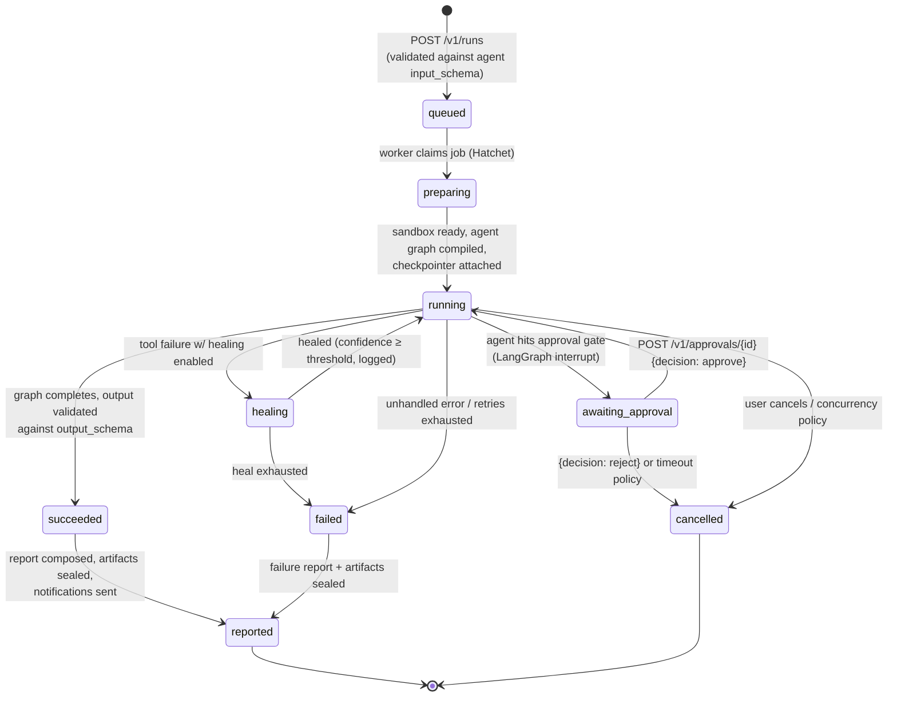
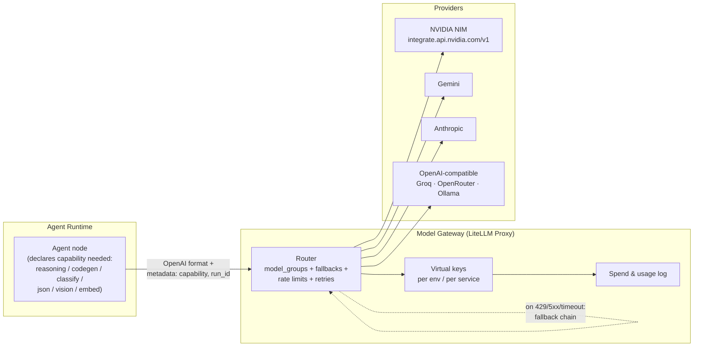
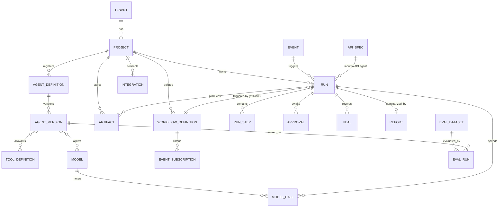
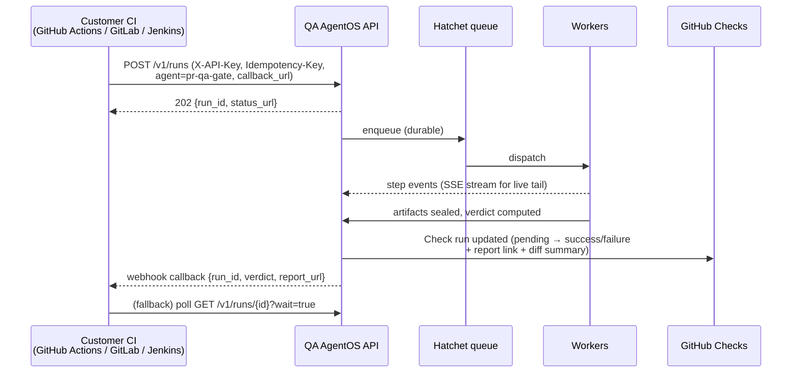
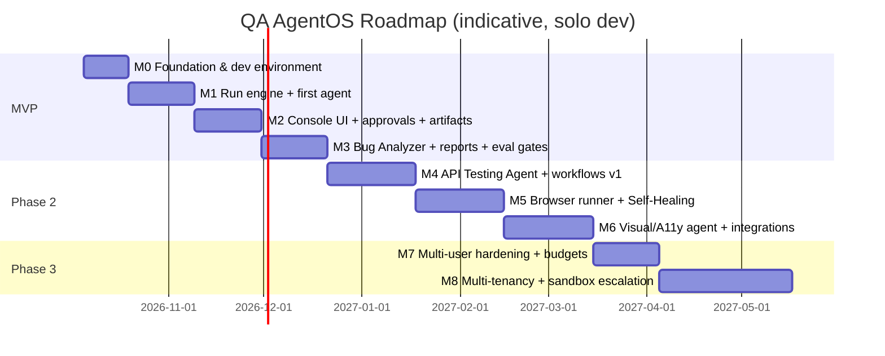

# QA AgentOS — Architecture & Design Dossier

> **Status:** Research & design complete. No code has been written — this document is the blueprint.
> **Date:** October 2026 · **Audience:** Solo developer / principal engineer · **Scope:** Personal MVP → production SaaS path
> **Reading time:** ~90 minutes. If you only read four sections, read **A**, **B**, **P**, and the **BUILD ORDER**.

---

## Table of Contents

- [A. Executive Architecture Summary](#a-executive-architecture-summary)
- [B. Recommended Complete Technology Stack](#b-recommended-complete-technology-stack) *(includes the 35-area technology evaluation)*
- [C. System Architecture Diagram](#c-system-architecture-diagram)
- [D. Agent Execution Lifecycle](#d-agent-execution-lifecycle)
- [E. Model Routing Architecture](#e-model-routing-architecture)
- [F. Database Schema](#f-database-schema)
- [G. API Architecture](#g-api-architecture)
- [H. Agent Registry Design](#h-agent-registry-design)
- [I. Tool Registry Design](#i-tool-registry-design)
- [J. Workflow Definition Design](#j-workflow-definition-design)
- [K. Artifact Storage Design](#k-artifact-storage-design)
- [L. Security Architecture](#l-security-architecture)
- [M. CI/CD Integration Architecture](#m-cicd-integration-architecture)
- [N. Local Development Architecture](#n-local-development-architecture)
- [O. Production Architecture](#o-production-architecture)
- [P. MVP Architecture](#p-mvp-architecture)
- [Q. Phase 2 Architecture](#q-phase-2-architecture)
- [R. Phase 3 Architecture](#r-phase-3-architecture)
- [S. Risks and Trade-offs](#s-risks-and-trade-offs)
- [T. Recommended Project Folder Structure](#t-recommended-project-folder-structure)
- [U. Engineering Roadmap](#u-engineering-roadmap)
- [V. Acceptance Criteria](#v-acceptance-criteria)
- [W. Recommended Initial MVP Scope](#w-recommended-initial-mvp-scope)
- [1. BUILD ORDER](#1-build-order)
- [2. WHAT NOT TO BUILD YET](#2-what-not-to-build-yet)
- [3. FIRST 10 IMPLEMENTATION TASKS](#3-first-10-implementation-tasks)
- [4. ARCHITECTURE DECISIONS](#4-architecture-decisions)
- [5. OPEN QUESTIONS](#5-open-questions)

---

## A. Executive Architecture Summary

**QA AgentOS is a single-modular-monolith platform, not a microservices system.** The entire control plane — REST API, agent orchestration, model gateway configuration, registries, and workflow engine — lives in one Python/FastAPI application. The only processes that scale independently are **execution workers** (the things that run Playwright, call LLMs, and execute tests), which are stateless containers pulling jobs from a **Postgres-backed durable task queue**. This is the single most important architectural decision in this document: it is what makes the platform buildable and operable by one person, while keeping every door open for later distribution.

The five agent capabilities (test-case generation, self-healing automation, bug/log analysis, API testing, visual regression + accessibility) are **not five services**. They are five *agent definitions* — declarative bundles of a system prompt, a tool allowlist, allowed models, parameters, and input/output JSON schemas — registered in a database-backed **Agent Registry** and executed by one generic **LangGraph-based agent runtime**. LangGraph is retained from your preferred direction, and the 2026 evidence supports it: it is the production standard for stateful, auditable agent workflows, with native checkpointing, human-in-the-loop interrupts via `interrupt()`, and roughly 34.5M monthly PyPI downloads, used in production by Klarna, Uber, LinkedIn, and JPMorgan ([Uvik](https://uvik.net/blog/agentic-ai-frameworks/), [Requesty](https://www.requesty.ai/blog/best-ai-agent-sdks-compared-2026-langchain-crewai-openai-anthropic-google)). New agents are added by writing a definition (and optionally a custom graph), never by rewriting the platform.

Everything models and tools touch flows through two narrow waists:

1. **The Model Gateway** — a self-hosted **LiteLLM proxy** presenting one OpenAI-compatible endpoint to the whole platform, routing to NVIDIA hosted NIM endpoints, Gemini, Anthropic, and any OpenAI-compatible provider, with per-key spend tracking and rate limiting. LiteLLM provides a unified OpenAI-compatible interface to 100+ providers with virtual keys and YAML-configured model routing ([Maxim](https://www.getmaxim.ai/articles/best-llm-gateways-in-2026/)). Models are *configuration*, not code, which satisfies the "swap models dynamically" and "agents can use multiple models" requirements.
2. **The Tool Registry** — every capability an agent can invoke (browser actions, HTTP requests, artifact reads, Jira/GitHub/Slack calls) is a versioned tool with a JSON Schema input/output contract, permissions, timeouts, and retry policy. Tools are exposed to agents through LangGraph tool nodes and, where useful, through **MCP (Model Context Protocol)** servers — Playwright MCP being the flagship example for exploratory browser automation ([Glama](https://glama.ai/mcp/best/browser-automation)).

**Data model conviction:** PostgreSQL is the system of record for *everything relational* — projects, agents, tools, models, runs, steps, approvals, eval results — and, via **pgvector**, also the vector store. pgvector is production-adequate for RAG workloads up to tens of millions of vectors, which is orders of magnitude beyond what this platform needs for years ([Olostep](https://www.olostep.com/blog/best-vector-database), [Medium/pratik-rupareliya](https://medium.com/@pratik-rupareliya/top-15-vector-databases-in-2026-a-production-decision-guide-from-100-enterprise-deployments-dd58a04f51a5)). MongoDB is rejected (see evaluation §16). Binary payloads — screenshots, videos, traces, logs, reports — never touch Postgres; they go to **S3-compatible object storage** (MinIO self-hosted at MVP, Cloudflare R2 or AWS S3 later) with only metadata and URIs in the database.

**Execution conviction:** agent runs are **asynchronous, durable, and replayable** by construction. A run is enqueued onto **Hatchet**, a Postgres-native durable task queue with DAG workflows, retries, durable sleep, per-tenant fair queuing, and rate limiting — chosen over Celery/Redis and over Temporal, because it reuses the Postgres you already operate instead of adding a broker, and because durable execution matches the "long-running agent that pauses for human approval and resumes" requirement exactly ([HN/Hatchet v1](https://news.ycombinator.com/item?id=43572733), [OpenApps](https://openapps.pro/apps/hatchet)). Redis survives in the stack, but in a reduced role: caching, rate-limit counters, and pub/sub fan-out for live run streaming to the UI.

**The two flows you mandated are realized as:**

- `Agent → Tool → Model → Artifact → Report`: an agent node calls a registered tool; tool results and model outputs are persisted as artifacts (screenshots, diffs, JSON results); a report generator composes artifacts + run metadata into a versioned report.
- `Event → Workflow → Agent → Worker → Artifact → Notification`: external events (GitHub push, Jira issue, Slack command, CI webhook, cron) are normalized into an `Event` row, matched to a `Workflow` definition, which enqueues agent runs on workers; completion writes artifacts and fires notifications (Slack/GitHub Check/Email).

**Human oversight is a platform primitive, not a feature bolted on per agent.** LangGraph's `interrupt()` pauses a graph, persists full state to the Postgres checkpointer, and resumes after an approval API call — every approval is a first-class `Approval` row linked to the run and step ([Requesty](https://www.requesty.ai/blog/best-ai-agent-sdks-compared-2026-langchain-crewai-openai-anthropic-google)). This directly implements "users can review and approve agent actions" and "every run is traceable and reproducible."

**Observability is self-hosted Langfuse** (MIT-licensed, OpenTelemetry-native, acquired by ClickHouse in January 2026 with the core staying open) for LLM tracing, prompt management, and evaluation datasets, plus structlog JSON logs and Prometheus metrics ([TrueFoundry](https://www.truefoundry.com/blog/langfuse-vs-langsmith), [OpenObserve](https://openobserve.ai/blog/langfuse-vs-langsmith/)). Agent quality is gated by **DeepEval** (pytest-native eval gates in CI) and **Promptfoo** (red-teaming and model-matrix sweeps) — the standard two-tool pattern in 2026 ([aiml.qa](https://aiml.qa/llm-evaluation-framework-benchmark-2026/), [qaskills](https://qaskills.sh/blog/promptfoo-vs-deepeval-2026)).

**Deployment reality for a solo developer:** the MVP runs as 6 Docker Compose services on one VPS (Caddy, Next.js frontend, FastAPI API, worker, Postgres+pgvector, MinIO; Redis and LiteLLM and Langfuse join as they earn their place), costing roughly a $6–20/month VPS plus metered LLM spend. A self-hosted PaaS like Coolify or Dokploy is a legitimate alternative to hand-maintained Compose on the same VPS; both are free and Git-driven ([Contabo](https://contabo.com/blog/self-hosted-paas-replace-heroku/), [virtua.cloud](https://www.virtua.cloud/learn/en/concepts/coolify-vs-dokploy-self-hosted-paas)).

**One-sentence verdict:** *Build a FastAPI modular monolith + Next.js UI on PostgreSQL, with LangGraph agents defined as data, LiteLLM as the model gateway, Hatchet as the durable queue, MinIO for artifacts, Playwright (and Playwright MCP) for browsers, axe-core for accessibility, Schemathesis for API fuzzing, Langfuse for LLM observability — and defer multi-tenancy hardening, sandboxed code execution, Kubernetes, Temporal, dedicated vector DBs, and SSO until Phase 3.*

---

## B. Recommended Complete Technology Stack

### B.1 The stack at a glance

Legend: **[R]** required for MVP · **[O]** optional (add when the pain is real) · **[D]** deferred (designed-for but not built yet)

| Layer | Choice | Status | Why (one line) |
|---|---|---|---|
| Frontend framework | **Next.js 16 + TypeScript** (App Router) | [R] | Your preference; industry default; Better Auth/Clerk ecosystem confirms Next.js 16 is the current line ([tech-insider](https://tech-insider.org/better-auth-vs-clerk-vs-nextauth-2026/)) |
| UI kit | Tailwind CSS + shadcn/ui + TanStack Query | [R] | Fast solo-dev velocity; server-state caching for run polling/streaming |
| Realtime UI | SSE (Server-Sent Events) via Redis pub/sub | [R] | Simpler than WebSockets for one-way run-event streaming; upgrade path to WS if bidirectional needed |
| Backend framework | **FastAPI + Python 3.12, Pydantic v2** | [R] | Your preference; native async, schema-first, shares language with agent/Playwright/Schemathesis ecosystem |
| ORM / migrations | SQLAlchemy 2.0 (async) + Alembic | [R] | Boring, proven, works with LangGraph Postgres checkpointer on the same DB |
| Agent orchestration | **LangGraph** (OSS library) + Postgres checkpointer | [R] | Graph state machines, `interrupt()` human-in-the-loop, checkpointing, replay; 2026 production standard ([Uvik](https://uvik.net/blog/agentic-ai-frameworks/)) |
| Agent framework fallback | Pydantic AI | [D] | Strongest Python alternative if LangGraph's ceremony hurts; type-safe, durable, OTel-native ([Langfuse](https://langfuse.com/blog/2025-03-19-ai-agent-comparison)) |
| Model gateway | **LiteLLM Proxy** (self-hosted, Docker) | [R] | One OpenAI-compatible endpoint → 100+ providers, virtual keys, spend tracking, rate limits ([Maxim](https://www.getmaxim.ai/articles/best-llm-gateways-in-2026/)) |
| Gateway upgrade path | Bifrost / managed (Requesty, OpenRouter) | [D] | LiteLLM's Python overhead shows at high concurrency; swap the gateway endpoint, not the agents ([Maxim](https://www.getmaxim.ai/articles/best-llm-gateways-in-2026/)) |
| Primary LLM provider | **NVIDIA hosted NIM** (`integrate.api.nvidia.com`) | [R] | OpenAI-compatible, strong free tier for development (details in §E) |
| Secondary providers | Google Gemini · Anthropic · any OpenAI-compatible | [R] (Gemini) / [O] (Anthropic) | Provider diversity for cost/quality routing and fallback |
| Local models | Ollama / vLLM endpoint registered in LiteLLM | [D] | Phase 3 privacy/offline option |
| Task queue / workflow engine | **Hatchet** (Postgres-native, self-hosted) | [R] | Durable execution, DAGs, retries, durable sleep (for approvals), fair multi-tenant queuing, rate limiting — on the Postgres you already run ([HN](https://news.ycombinator.com/item?id=43572733)) |
| Queue alternative (simpler) | Dramatiq or arq on Redis | [O] | If Hatchet's dashboard/engine feels heavy in week 1; the Run queue abstraction hides the swap ([aleksul.space](https://aleksul.space/posts/choosing-python-task-queue-library/)) |
| Queue alternative (heavier) | Temporal | [D] | Overkill for one developer; revisit at Phase 3 scale |
| Database | **PostgreSQL 17** + JSONB | [R] | One store for control plane, queues (Hatchet), checkpoints (LangGraph), and vectors (pgvector) |
| Vector search | **pgvector** | [R] | Production-adequate to ~50M vectors; zero new infrastructure ([Olostep](https://www.olostep.com/blog/best-vector-database)) |
| Dedicated vector DB | Qdrant / Weaviate / Pinecone | [D] | Only if retrieval latency or scale outgrows pgvector |
| Cache / pub-sub | **Redis** | [O] for MVP, [R] later | Cache, rate-limit counters, SSE fan-out; not required as a broker because Hatchet uses Postgres |
| Object storage | **MinIO** (S3-compatible) | [R] | Artifacts (screenshots/videos/traces/reports); swap to Cloudflare R2 / AWS S3 by changing endpoint |
| Browser automation | **Playwright (Python + Node runner image)** | [R] | Your preference; the 2026 default for web E2E (86.7M weekly npm pulls) ([testdino](https://testdino.com/blog/ai-visual-regression-testing)) |
| Agentic browser tool | **Playwright MCP server** | [R] | 25 tools over accessibility snapshots; the standard MCP browser server ([Glama](https://glama.ai/mcp/best/browser-automation)) |
| Accessibility engine | **axe-core via @axe-core/playwright** | [R] | Your preference; de-facto standard WCAG engine in a live browser context ([qaskills](https://qaskills.sh/blog/axe-core-playwright-accessibility-testing-2026)) |
| Visual regression | **Playwright `toHaveScreenshot`** (pixelmatch, WebP baselines since v1.62) | [R] | Free, built-in, versionable; baselines in object storage, not Git, for this platform ([testdino](https://testdino.com/blog/ai-visual-regression-testing)) |
| Visual regression upgrade | Argos (OSS, self-hostable, free 5k shots/mo cloud) | [O] | Adds review UI + Git-based baselines when diffs need team review ([Argos](https://argos-ci.com/blog/best-visual-regression-testing-tools)) |
| Visual regression enterprise | Percy / Applitools | [D] | Paid AI diffing; only if false-positive volume justifies spend |
| API test generation | **Schemathesis** (property-based, OpenAPI/GraphQL, Hypothesis-powered) | [R] | Generates thousands of schema-conformant cases; CLI + pytest modes ([qaskills](https://qaskills.sh/blog/schemathesis-openapi-property-testing)) |
| Spec linting | Stoplight Spectral | [O] | Lint OpenAPI specs before generation ([totalshiftleft](https://totalshiftleft.ai/blog/top-openapi-testing-tools-compared-2026)) |
| OpenAPI parsing | `openapi-spec-validator` + `prance` (or `openapi-pydantic`) | [R] | Resolve `$ref`s, normalize to OpenAPI 3.1 |
| API test execution | httpx (async) + pytest harness in worker | [R] | Same Python stack; results streamed to artifacts |
| LLM observability | **Langfuse** (self-host, MIT core) | [R] | Traces, prompt registry, datasets, eval scores; free self-host, all tiers ([TrueFoundry](https://www.truefoundry.com/blog/langfuse-vs-langsmith)) |
| App observability | structlog JSON logs + Prometheus + Grafana | [O] | Add Grafana when you have something to graph; Sentry (or GlitchTip self-host) for exceptions |
| Agent evaluation | **DeepEval** (pytest gates) + **Promptfoo** (red-team/model matrix) | [R] (DeepEval) / [O] (Promptfoo) | The standard two-tool pattern: metric gates in CI + adversarial sweeps nightly ([aiml.qa](https://aiml.qa/llm-evaluation-framework-benchmark-2026/)) |
| Prompt management | Langfuse prompt registry + DB-versioned prompts exported to Git | [R] | Versioned, labeled prompts; rollback = redeploy label |
| AuthN (MVP) | FastAPI OAuth2 password flow, JWT (RS256), Argon2 hashing | [R] | Zero dependencies beyond libraries; you are the only user at MVP |
| AuthN (Phase 2) | Clerk / Logto / Authlib OIDC | [O] | Note: the popular Better Auth is **TypeScript-only**, so it does not fit a FastAPI backend; verify Clerk/Logto JWTs at the API ([makerkit](https://makerkit.dev/blog/tutorials/better-auth-vs-clerk)) |
| RBAC | Role column (`owner/admin/member/viewer`) + permission checks in dependencies | [R] | Table-driven; graduate to workspace-scoped policies in Phase 3 |
| Secrets (MVP) | `.env` + Docker secrets + git-crypt/SOPS for repo | [R] | One developer, one server — Vault is overkill |
| Secrets (Phase 2) | **Infisical** (MIT, self-hostable) | [O] | Best open-source DX; Vault/OpenBao deferred as too heavy ([GitGuardian](https://blog.gitguardian.com/top-secrets-management-tools/), [Bytebase](https://www.bytebase.com/blog/best-secrets-manager-for-database-credentials/)) |
| Secrets for user tokens | Fernet envelope encryption in Postgres (key from env/KMS) | [R] from Phase 2 | Jira/GitHub PATs and OAuth refresh tokens are encrypted at rest |
| Sandbox (MVP) | Disposable Docker containers per browser/test run, no creds, resource limits, egress allowlist | [R] | Adequate when *you* choose the targets |
| Sandbox (Phase 3) | gVisor runtime or E2B (Firecracker microVMs) | [D] | Required only when running untrusted/user-submitted code ([Beam](https://www.beam.cloud/blog/best-stateful-sandbox-code-execution-2026)) |
| GitHub integration | GitHub App (not OAuth app) + Checks API + webhooks | [R] (Phase 2) | Fine-grained permissions, installation tokens, PR check runs |
| Jira integration | Jira Cloud REST API v3, OAuth 2.0 (3LO) or API token, webhooks | [O] | Bug Analyzer creates/updates issues |
| Slack integration | Slack Bolt for Python, slash commands + interactive approvals + notifications | [O] | Approve/reject agent actions from Slack |
| MCP support | MCP client in agent runtime; MCP servers as tool adapters | [R] | MCP is the 2026 interoperability standard; auth spec hardened mid-2026 ([MCP blog](https://blog.modelcontextprotocol.io/posts/2026-07-28-release-candidate/)) |
| CI (platform itself) | GitHub Actions | [R] | Build, test, eval gates, image publish, deploy to VPS |
| Deployment (MVP) | Single VPS + Docker Compose + Caddy | [R] | ~$6–20/mo; Coolify/Dokploy optional dashboard on top ([Contabo](https://contabo.com/blog/self-hosted-paas-replace-heroku/)) |
| Deployment (production) | 2–3 VPS or managed K8s, managed Postgres, R2/S3 | [D] | Phase 3, driven by load, not ambition |

### B.2 Evaluation of the 35 areas

Each area: **verdict** + what would change my mind.

1. **Frontend frameworks — Next.js + TypeScript confirmed.** React's ecosystem, server components for the console UI, and the strongest hiring/AI-codegen training distribution make this the low-risk choice. Alternatives considered: SvelteKit (less agent-tooling coverage), plain Vite SPA (fine, but you lose SSR/SEO for a future marketing site). Verdict: **[R] Next.js**.
2. **Backend frameworks — FastAPI confirmed.** The agent ecosystem (LangGraph, LiteLLM, Schemathesis, Playwright Python, DeepEval) is Python-first; a Node backend would split the stack. Django would bundle auth/admin but fights async agent workloads. Verdict: **[R] FastAPI**.
3. **Agent orchestration — LangGraph confirmed, with scoping discipline.** Use the OSS library, not LangGraph Platform (its self-host is enterprise-gated and you already have workers + Postgres). CrewAI is faster to demo but carries up to 3× token overhead on simple flows and weaker determinism — wrong trade for a QA platform where reproducibility is a product requirement ([Uvik](https://uvik.net/blog/agentic-ai-frameworks/), [Requesty](https://www.requesty.ai/blog/best-ai-agent-sdks-compared-2026-langchain-crewai-openai-anthropic-google)). Verdict: **[R] LangGraph**; keep agent graphs thin so a Pydantic AI migration stays possible.
4. **Model gateway/provider abstraction — LiteLLM Proxy.** A standalone container, config in YAML, virtual keys per environment, spend tracking, OpenAI-compatible surface. Known caveat: Python/GIL overhead at high concurrency — irrelevant at personal scale, and Bifrost-class gateways are drop-in replacements later ([Maxim](https://www.getmaxim.ai/articles/best-llm-gateways-in-2026/)). Verdict: **[R] LiteLLM**.
5. **LLM providers — NVIDIA-first, multi-provider from day one.** NVIDIA hosted NIM for development economics, Gemini for cheap/fast classification and long context, Anthropic for highest-quality reasoning when it matters, any OpenAI-compatible endpoint (Groq, OpenRouter, Together) via the same client. All routing lives in the gateway, so providers are rows in config. Verdict: **[R] NVIDIA + Gemini; [O] Anthropic**.
6. **NVIDIA NIM / hosted inference — see §E for the full model mapping.** Key facts: build.nvidia.com hosts a broad catalog (46+ free models from 12 publishers as of May 2026, including MiniMax M2.7, Qwen3 Coder 480B, Mistral Large 3 675B, Llama 4 Maverick) via OpenAI-compatible endpoints; a free Developer Program key ships with roughly 1,000 credits and a ~40 requests/minute cap ([aitoolsmentor](https://www.aitoolsmentor.com/blog/free-ai-models-nvidia-nim-complete-guide-2026), [Substack](https://sidsaladi.substack.com/p/free-llm-api-nvidia-nim)). **Treat the free tier as a development accelerator, not a production plan** — the catalog churns (models are deprecated and replaced; see the community deprecation threads ([NVIDIA forums](https://forums.developer.nvidia.com/t/model-deprecation-request/378412))) and production needs paid NIM/partner endpoints or another provider. Verdict: **[R] for dev, with hard-coded health-check + fallback routing**.
7. **Browser automation — Playwright, dual-mode.** (a) *Deterministic mode*: generated/curated Playwright specs executed in runner containers — this is the regression layer. (b) *Agentic mode*: Playwright MCP server exposing ~25 tools (navigate, click, fill, snapshot, network inspection) over accessibility trees rather than screenshots, so agents explore without vision models ([Glama](https://glama.ai/mcp/best/browser-automation)). Critical design rule from practice: **an MCP chat transcript is not a regression suite** — exploratory runs must be distilled into versioned spec files ([qaskills](https://qaskills.sh/blog/playwright-mcp-browser-automation-guide)). Verdict: **[R] both modes**.
8. **Playwright MCP — adopt as a tool server, not as the execution engine.** MCP loads tool schemas and accessibility trees into model context, which is exactly what an exploratory agent wants and exactly what a 500-test regression run cannot afford. Verdict: **[R] MCP for exploration/healing; [R] generated specs for regression**.
9. **Accessibility testing — axe-core confirmed.** `@axe-core/playwright` runs Deque's engine inside the live page and returns typed violations to assert on; automated scanning catches the machine-detectable slice (a Deque study puts it at ~57% of issues by volume) — the rest needs human review, which your human-approval flow already models ([testdino](https://testdino.com/blog/playwright-accessibility), [qaskills](https://qaskills.sh/blog/axe-core-playwright-accessibility-testing-2026)). Verdict: **[R] axe-core**, Chromium-only (a11y violations are DOM-level, not rendering-level).
10. **Visual regression — Playwright-native first.** `toHaveScreenshot()` with pixelmatch/YIQ thresholds and lossless WebP baselines (since Playwright 1.62, July 2026) covers the MVP at zero cost; add `toMatchAriaSnapshot()` for structure checks that agents can read ([testdino](https://testdino.com/blog/ai-visual-regression-testing)). Unlike repo-based suites, QA AgentOS stores baselines in **object storage** keyed by project/page/viewport, with human approval of baseline promotions. Upgrade path: **Argos** (open source, self-hostable, real review UI, free tier) when diff review becomes a workflow; avoid Lost Pixel (sunsetting — the team joined Figma in April 2026) and treat BackstopJS as legacy/dormant ([Argos](https://argos-ci.com/blog/best-visual-regression-testing-tools), [overlayqa](https://overlayqa.com/blog/visual-regression-testing-tools/)). Verdict: **[R] Playwright; [O] Argos; [D] Percy/Applitools**.
11. **API test generation/execution — LLM generates, Schemathesis fuzzes, pytest executes.** The API Testing Agent composes example-based test cases (LLM with structured output against the parsed spec), while Schemathesis provides property-based fuzzing — thousands of generated cases with automatic shrinking of failures to minimal repros ([apidog](https://apidog.com/blog/what-is-schemathesis/)). Execution is async httpx inside a worker with per-run sandboxes of auth headers. Verdict: **[R] Schemathesis + httpx/pytest**.
12. **OpenAPI/Swagger parsing — `prance`/`openapi-spec-validator`, normalized to 3.1.** Parse, resolve `$ref`s, validate, and convert to an internal `ApiSpec` model stored as JSONB. Lint optionally with Spectral. Verdict: **[R]**.
13. **Test execution architecture — ephemeral containers, one per run.** A worker claims a run, spawns (or *is*) a container with the Playwright image, mounts nothing sensitive, enforces CPU/memory/time limits, streams events to Redis pub/sub, and writes artifacts to MinIO. Browser runs and API runs share the runner contract (`run_id` in, artifact URIs + verdict out). Verdict: **[R]**.
14. **Asynchronous job execution — everything user-triggered beyond a few hundred ms is a job.** Runs, report generation, integrations sync, embedding jobs. API returns `202 Accepted` + `run_id`; UI subscribes to the event stream. Verdict: **[R]**.
15. **Queues — Hatchet over Celery, deliberately.** Celery remains fine but defaults bite (pre-execution acks) and it wants Redis/RabbitMQ as broker ([aleksul.space](https://aleksul.space/posts/choosing-python-task-queue-library/)). Hatchet is Postgres-native (no new stateful infra), durable (tasks resume after crashes), and ships fair queuing + rate limits — the exact features a multi-agent platform needs when five tenants' runs compete ([HN](https://news.ycombinator.com/item?id=43572733), [Medium](https://medium.com/@hazqeelafyq09/self-host-hatchet-full-stack-app-on-aws-b7b9c3a2adc8)). Temporal is the "correct" enterprise answer and the wrong solo-developer answer. Verdict: **[R] Hatchet; [D] Temporal**.
16. **PostgreSQL vs MongoDB — PostgreSQL, and it isn't close.** Runs, agents, tools, and approvals are relational with invariants (foreign keys, status transitions, unique constraints); the genuinely document-shaped payloads (spec snapshots, step payloads, model configs) fit JSONB with GIN indexes; pgvector removes the last reason to add a second store. MongoDB would add an operational tax and lose transactional integrity across run state + artifacts metadata. Verdict: **[R] Postgres; Mongo rejected**.
17. **Redis use cases — narrowed by the Hatchet choice.** Keep Redis for: (a) response/session cache, (b) token-bucket rate limiting on the public API, (c) pub/sub fan-out for live run events to SSE clients, (d) LiteLLM's optional cache. Do not use it as the system of record or the job broker. Verdict: **[O] at MVP, [R] in practice by Phase 2**.
18. **Object storage — S3 API from day one, MinIO first.** Every artifact gets a content-addressed key (`{project}/{run}/{step}/{sha}.{ext}`), server-side lifecycle rules for video retention, and presigned URLs so the browser downloads screenshots directly from storage rather than proxying through the API. Verdict: **[R] MinIO → R2/S3**.
19. **Vector database requirements — pgvector, used sparingly.** Real use cases: retrieval over past bug reports ("have we seen this stack trace?"), similarity search over test cases to avoid duplicates, and retrieval over project docs for the Test Case Generator. All are < 1M vectors for the foreseeable future — deep in pgvector's comfort zone ([Olostep](https://www.olostep.com/blog/best-vector-database)). Verdict: **[R] pgvector; [D] Qdrant/Pinecone**.
20. **GitHub integration — GitHub App, never a personal PAT.** Apps get fine-grained permissions, installation-scoped tokens, and the Checks API for posting run results onto PRs. Webhooks (push, pull_request) feed the Event→Workflow flow. Verdict: **[R] Phase 2**.
21. **Jira integration — REST API v3 + OAuth 2.0 (3LO) app, API token acceptable at MVP.** The Bug Analyzer creates issues with structured fields (severity from model classification, repro steps, artifact links); incoming webhooks let "new bug reported" trigger the analyzer. Verdict: **[O] Phase 2**.
22. **Slack integration — Bolt for Python.** Three use cases only: notifications (run finished, approval needed), interactive approvals (buttons calling back the approval endpoint), and a `/qa` slash command to trigger runs. Verdict: **[O] Phase 2**.
23. **Secrets management — staged.** MVP: `.env` + Docker secrets, SOPS-encrypted in Git. Phase 2: Infisical self-hosted (MIT, good DX, dynamic secrets roadmap) — Vault/OpenBao are operationally heavy for one person ([devopsboys](https://devopsboys.com/blog/infisical-secrets-manager-review-2026), [keyway](https://keyway.sh/articles/infisical-vs-openbao)). Platform-held user secrets (Jira/GitHub tokens) are always Fernet-encrypted in Postgres regardless of stage. Verdict: **[R] SOPS now; [O] Infisical later**.
24. **Authentication — staged, API-first.** MVP: single-user OAuth2 password flow issuing RS256 JWTs, plus long-lived **API keys** for CI triggers (these matter more than login at MVP). Phase 2: OIDC via Clerk/Logto, verified at FastAPI. The 2026 TypeScript favorite Better Auth does not apply — it runs inside TS apps, not FastAPI ([makerkit](https://makerkit.dev/blog/tutorials/better-auth-vs-clerk)). Verdict: **[R] JWT+API keys; [O] managed OIDC**.
25. **RBAC — roles as data, enforced in FastAPI dependencies.** Four roles (`owner`, `admin`, `member`, `viewer`) with a permission matrix table; agent/tool definitions carry a `required_permission` so dangerous tools (e.g., `jira.create_issue`) can't be invoked by read-only contexts. Casbin/OSO deferred. Verdict: **[R] simple matrix; [D] policy engines**.
26. **Observability — three lanes, one correlation ID.** Lane 1: structlog JSON logs with `run_id`/`step_id` on every line. Lane 2: Langfuse self-hosted for LLM traces, prompt versions, eval scores — MIT core, self-hostable on all tiers, OTel-native ([TrueFoundry](https://www.truefoundry.com/blog/langfuse-vs-langsmith)). Lane 3: Prometheus metrics (queue depth, run duration, token spend) with Grafana added when needed. Verdict: **[R] structlog+Langfuse; [O] Prometheus/Grafana; [D] full OTel collector mesh**.
27. **Evaluation of AI agents — eval gates are part of the product, not an afterthought.** DeepEval runs in CI as pytest-native metric gates (G-Eval rubrics for test-case quality, faithfulness for bug summaries, tool-use metrics for agents) ([deepeval](https://deepeval.com/blog/top-5-llm-evaluation-frameworks)). Promptfoo runs nightly model-matrix + red-team sweeps. Golden datasets live in Git and are versioned with agent definitions — a prompt or model change that regresses evals fails the build, which is exactly the discipline a QA platform should dogfood. Verdict: **[R] DeepEval; [O] Promptfoo**.
28. **Prompt/version management — prompts are versioned rows, Langfuse-mirrored.** Each agent version pins prompt template + model + parameters; Langfuse provides the interactive registry and labels; a Git export keeps prompts reviewable in PRs. Verdict: **[R]**.
29. **Agent memory — three tiers, only two built now.** Tier 1 (run state): LangGraph Postgres checkpointer — free. Tier 2 (cross-run knowledge): artifacts + pgvector retrieval — built with §19. Tier 3 (autonomous long-term memory, Mem0-style): **[D]** — high complexity, low value until agents have months of history.
30. **Multi-tenancy — single-tenant code, tenant-shaped schema.** Every table carries `project_id`/`tenant_id` foreign keys from day one (cheap), but there is no workspace UI, no RLS, no billing until Phase 3. This is the standard "design for, don't build" pattern. Verdict: **[R] schema-level; [D] product-level**.
31. **Security — see §L.** Headlines: SSRF guard on all browser/HTTP tools, egress allowlists on runners, encrypted user secrets, scoped API keys, prompt-injection mitigations for log/issue ingestion, rate limits. Verdict: **[R] baseline; [D] SOC 2 theater**.
32. **Sandboxing browser/code execution — containers now, microVMs when untrusted input arrives.** MVP targets are *your* apps, so Docker containers with dropped caps, no network beyond an allowlist, and read-only rootfs suffice. The moment you let arbitrary users point agents at arbitrary sites or submit code, graduate to gVisor or Firecracker-backed sandboxes (E2B is the managed reference; 24h session caps and no GPU are its known limits) ([Beam](https://www.beam.cloud/blog/best-stateful-sandbox-code-execution-2026)). Verdict: **[R] hardened containers; [D] microVMs**.
33. **CI/CD architecture — the platform dogfoods its own model.** GitHub Actions builds/tests/deploys the platform; the platform exposes `POST /v1/runs` + webhooks so *other* projects' CIs trigger QA runs and receive GitHub Check results. Verdict: **[R]**.
34. **Deployment options for a personal MVP — boring and cheap.** One VPS (Hetzner/Contabo class, 4–8GB RAM) + Docker Compose + Caddy. If you want a dashboard, Dokploy (lighter, Compose-native) or Coolify (more features, heavier, watch its CVE history and keep the dashboard private) sit on the same VPS ([virtua.cloud](https://www.virtua.cloud/learn/en/concepts/coolify-vs-dokploy-self-hosted-paas)). Managed Postgres (Neon/Supabase) is an acceptable swap if you don't want to own backups. Verdict: **[R] VPS+Compose**.
35. **Path from MVP to production SaaS — see P/Q/R.** The contract: every Phase-2/3 capability is reachable by *adding* components (managed DB, more workers, sandbox runtime, OIDC, RLS) rather than rewriting. Verdict: **phased architecture is the strategy**.

---

## C. System Architecture Diagram

The diagram below is the whole platform. Everything left of the workers is the **control plane** (one deployable); everything right of the queue is the **data plane** (horizontally scalable, disposable).

```mermaid
flowchart TB
    subgraph Clients["Clients"]
        UI["Next.js Web UI<br/>(console, run viewer, approvals)"]
        CLI["CLI / curl<br/>(CI pipelines)"]
        EXT["External Events<br/>GitHub webhook · Jira webhook · Slack · cron"]
    end

    subgraph Edge["Edge"]
        CADDY["Caddy reverse proxy<br/>TLS, rate limit headers"]
    end

    subgraph ControlPlane["Control Plane — FastAPI modular monolith (single deployable)"]
        API["API Layer<br/>REST /v1 · SSE /v1/runs/{id}/events"]
        AUTHN["AuthN/Z<br/>JWT + API keys + RBAC deps"]
        subgraph Core["Core Services (modules, not microservices)"]
            AGENTREG["Agent Registry<br/>(definitions, versions)"]
            TOOLREG["Tool Registry<br/>(schemas, permissions, policies)"]
            WFENG["Workflow Engine<br/>(event → workflow matching)"]
            SCHED["Run Scheduler<br/>(enqueue, priority, quota)"]
            APPROVAL["Approval Service<br/>(human-in-the-loop)"]
            REPORT["Report Service<br/>(artifact → report composer)"]
        end
        GWCFG["Model Gateway Config<br/>(model catalog, routing rules)"]
    end

    subgraph Infra["Infrastructure (Docker Compose services)"]
        PG[("PostgreSQL 17<br/>+ pgvector<br/>control plane · Hatchet · LangGraph checkpoints")]
        REDIS[("Redis<br/>cache · rate limits · SSE pub/sub")]
        MINIO[("MinIO (S3)<br/>artifacts: screenshots, videos,<br/>traces, logs, reports")]
        HATCHET["Hatchet engine<br/>durable task queue (on Postgres)"]
        LITELLM["LiteLLM Proxy<br/>OpenAI-compatible gateway"]
        LANGFUSE["Langfuse (self-host)<br/>LLM traces · prompts · evals"]
    end

    subgraph DataPlane["Data Plane — Execution Workers (stateless, autoscaled by queue depth)"]
        W1["Agent Worker<br/>LangGraph runtime"]
        W2["Browser Runner<br/>Playwright + axe-core + MCP"]
        W3["API Runner<br/>httpx + Schemathesis"]
    end

    subgraph Providers["Model Providers (behind gateway)"]
        NVIDIA["NVIDIA NIM<br/>integrate.api.nvidia.com"]
        GEMINI["Google Gemini"]
        ANTH["Anthropic"]
        OAIC["Any OpenAI-compatible<br/>(Groq, OpenRouter, Ollama…)"]
    end

    subgraph SaaS["Integration SaaS"]
        GH["GitHub<br/>(App, Checks, webhooks)"]
        JIRA["Jira Cloud"]
        SLACK["Slack"]
    end

    UI --> CADDY --> API
    CLI --> CADDY
    EXT --> CADDY
    API --> AUTHN
    API --> AGENTREG & TOOLREG & WFENG & SCHED & APPROVAL & REPORT
    API --> GWCFG
    SCHED --> HATCHET
    HATCHET --> W1 & W2 & W3
    W1 --> AGENTREG & TOOLREG
    W1 --> LITELLM
    W2 --> LITELLM
    W3 --> LITELLM
    LITELLM --> NVIDIA & GEMINI & ANTH & OAIC
    W1 & W2 & W3 --> MINIO
    W1 & W2 & W3 --> PG
    W1 & W2 & W3 --> REDIS
    W1 & W2 & W3 --> LANGFUSE
    APPROVAL --> REDIS
    API --> PG & REDIS & MINIO
    HATCHET --> PG
    LITELLM --> REDIS
    LANGFUSE --> PG
    W1 --> GH & JIRA & SLACK
    REPORT --> MINIO
    REPORT --> SLACK
```



**Reading guide.** The UI and external events both terminate at the same API layer — there is no separate "webhook service" at MVP; a `/v1/events` endpoint with per-source signature verification (GitHub HMAC, Jira/Slack secrets) normalizes everything into the `events` table, and the Workflow Engine matches events to workflow definitions. Workers never receive inbound HTTP; they only poll Hatchet. Models are never called directly from agent code — the only base URL in the entire system is the LiteLLM proxy's, which is what makes model swapping a config change. Artifacts flow one way (worker → MinIO → presigned URL → browser), keeping big binaries off the API process.

---

## D. Agent Execution Lifecycle

A run's lifecycle is a state machine persisted in Postgres (`runs.status`) and mirrored in LangGraph checkpoints. Every transition is an event; every event is queryable.



**The twelve steps of a run, in order:**

1. **Intake & validation.** `POST /v1/runs {project, agent@version, input, model?, workflow?}`. Input is validated against the agent's `input_schema` (JSON Schema). The caller's identity (user JWT or CI API key) is checked against RBAC and per-project quotas. Response: `202` + `run_id`.
2. **Persistence & enqueue.** A `runs` row (`queued`) and a Hatchet task are written in the same Postgres transaction — no lost or phantom runs.
3. **Claim & prepare.** A worker with capacity (concurrency slots, per-project fairness) claims the task. It resolves the agent definition version, tool allowlist, and model assignment; it warms a sandbox if the agent needs a browser.
4. **Graph compilation.** The generic runtime compiles the LangGraph graph for this agent type: planner node → tool-call loop → verifier node → (optional) approval gates → output formatter. The Postgres checkpointer is attached with `thread_id = run_id`, making the whole run resumable and replayable.
5. **Execution loop.** Each node execution emits `run_steps` rows (input, output, tool calls, model calls, token counts, latency) and publishes events to Redis for the live UI. Every model call goes through LiteLLM (which enforces rate limits, logs spend, and retries transient provider errors); every tool call goes through the Tool Registry (which enforces permissions, timeouts, and retry policy).
6. **Approval gates.** When a node declares `requires_approval` (e.g., "promote healed locator", "create Jira issue", "promote visual baseline"), the graph `interrupt()`s, the run moves to `awaiting_approval`, and an `approvals` row + notification (UI badge / Slack button) are created. Approval resumes the checkpoint with the decision injected; rejection follows the graph's rejection edge (usually → graceful failure report). A per-agent `approval_timeout` policy (default: fail-safe to `cancelled` after 24h) prevents zombie runs.
7. **Failure & healing.** Tool failures enter the agent's healing policy. For browser steps this is the self-healing path: capture accessibility snapshot → LLM proposes a candidate element (grounded in the real snapshot, so it cannot hallucinate a selector) → apply only if confidence ≥ threshold → log every heal to `heals` for human review ([qaskills](https://qaskills.sh/blog/self-healing-tests-playwright), [Medium/tito](https://medium.com/@tito.irfanwibisono/self-healing-test-automation-with-playwright-and-llms-guide-d49c20d86309)). The cardinal rule, encoded in the verifier: **actions may heal; assertions never heal** — a healed assertion would mask real regressions.
8. **Output validation.** The agent's raw output is validated against `output_schema` (structured output enforced at the provider level where supported, retried with a repair prompt otherwise). Invalid output after N repairs = `failed` with a typed error — never silently shipped.
9. **Artifact sealing.** All produced artifacts are uploaded to MinIO with content-addressed keys; metadata rows (`artifacts`) link them to run and step. Sealing is the point after which a run's evidence is immutable.
10. **Report composition.** The Report Service renders the run into a versioned report (HTML + JSON + optional PDF): summary, verdict, step timeline, artifact gallery, diffs, token/latency/cost table, heals applied, approvals taken.
11. **Notification.** Workflow-level notification rules fire: Slack message, GitHub Check update, Jira comment, email. Failures route differently than successes (e.g., failures ping Slack; successes only update the GitHub Check).
12. **Retention & replay.** Run rows are retained per project policy; artifacts per lifecycle rule (videos expire first). Any past run can be **re-executed** (same agent version, model, input, and pinned tool versions → new run linked by `replayed_from`), which is what "reproducible" means in practice.

---

## E. Model Routing Architecture

### E.1 Architecture



Design rules:

- **Agents request capabilities, not models.** An agent definition lists `allowed_models` per capability slot (`planner`, `coder`, `classifier`, `vision`); the scheduler resolves the concrete model at run start from the **Model Registry** (§F), filtered by tenant policy and current provider health. This is how "models can be swapped dynamically" and "agents can use multiple models" become config rather than code.
- **The gateway owns resilience.** Fallback chains (`nvidia/llama-4-maverick → gemini-2.5-flash → anthropic/…`), per-model RPM limits, context-window guards, and retries live in LiteLLM config. Agent code never sees a 429 — it sees a slower response or a typed `AllProvidersUnavailable` error.
- **The gateway owns metering.** Every call is tagged (`run_id`, `agent`, `capability`) via metadata; LiteLLM's spend log is reconciled nightly into the `model_calls` table for per-run cost attribution. LLM spend is typically 40–60% of agent OpEx, so per-run cost is a first-class UI field, not an afterthought ([Uvik](https://uvik.net/blog/agentic-ai-frameworks/)).
- **Structured output is a contract, not a hope.** Where the provider supports JSON schema response formats, the gateway passes the schema through; otherwise the runtime adds a validate-and-repair loop (max 2 repairs) before failing the step.

### E.2 NVIDIA hosted endpoints — current catalog findings (October 2026)

NVIDIA's hosted catalog (build.nvidia.com, API base `https://integrate.api.nvidia.com/v1`) is **OpenAI-compatible**, which is why it slots into LiteLLM with zero custom code ([Substack](https://sidsaladi.substack.com/p/free-llm-api-nvidia-nim)). Key operational facts for planning:

- **Free tier reality:** a free Developer Program key comes with ~1,000 one-time credits (≈ 1 API call each) and a **~40 requests/minute** rate limit; the catalog marketing page advertises dozens of models at no cost, but the credit + RPM envelope means it is a **development and evaluation tier, not a production SLA** ([Substack](https://sidsaladi.substack.com/p/free-llm-api-nvidia-nim), [aitoolsmentor](https://www.aitoolsmentor.com/blog/free-ai-models-nvidia-nim-complete-guide-2026)). Production use means paid NIM/partner endpoints (e.g., NVIDIA's flagship Nemotron 3 Super 120B is only available via paid partners like CoreWeave/DigitalOcean) or another provider ([aitoolsmentor](https://www.aitoolsmentor.com/blog/free-ai-models-nvidia-nim-complete-guide-2026)).
- **Catalog churn is real.** Models are deprecated and replaced as the ecosystem moves (e.g., community requests to replace Kimi 2.6, MiniMax M2.7, Qwen3-Next-80B with newer versions) ([NVIDIA forums](https://forums.developer.nvidia.com/t/model-deprecation-request/378412)). **Design consequence:** model IDs live in the Model Registry (DB rows + gateway config), never in agent code, and a nightly health-check job marks deprecated models `unavailable` and re-points capability defaults.
- **Recommended capability mapping** (verify current IDs in the catalog before each quarterly review — treat this table as a snapshot):

| Capability slot | Primary (NVIDIA NIM) | Fallback | Notes |
|---|---|---|---|
| **Reasoning / planning** | `deepseek-ai/deepseek-v*` (R-class reasoning), `qwen/qwen3-next-80b-a3b-instruct`, Step-3.5 Flash (200B MoE, agentic) | Gemini 2.5 Pro/Flash; Anthropic Sonnet-class | Planner quality is the biggest lever on agent success; spend here first |
| **Code generation** | `qwen/qwen3-coder-480b-a35b-instruct` (256K ctx, agentic-coding tuned), MiniMax M2.7 (230B MoE, strong coding) | Anthropic Sonnet-class; Gemini | Used by Test Case Generator (spec synthesis) and Self-Healing (locator proposals) |
| **Classification / triage** | Small/cheap: Gemma 3n, Nemotron Nano class, Llama 3.3 70B | Gemini Flash-class | Bug severity/duplicate classification; high volume → optimize $/call |
| **Structured JSON generation** | Mistral Nemotron (built for function calling), Llama 4 Maverick, Qwen3 family | Any provider with JSON-schema mode | Prefer native `response_format`; repair loop as backstop ([aitoolsmentor](https://www.aitoolsmentor.com/blog/free-ai-models-nvidia-nim-complete-guide-2026)) |
| **Vision / multimodal** | Llama 4 Maverick (multimodal, most-used on platform), `nvidia/nemotron-nano-12b-v2-vl`, `meta/llama-3.2-90b-vision-instruct`, Phi-4 Multimodal | Gemini (strong native vision) | Visual diff explanation, screenshot summarization, "what changed on this page" |
| **Embeddings** | `nvidia/nv-embed-v1` (text), NV-EmbedCode 7B (code) | Gemini embeddings | Feeds pgvector (§19) |

- **Rate-limit engineering for 40 RPM:** the scheduler enforces per-provider concurrency caps (LiteLLM `rpm` limits per model group), queues burst work instead of erroring (Hatchet rate limits), and routes bulk/classification traffic to the cheapest healthy provider. If you outgrow the free tier mid-development, the first paid move is one provider's pay-as-you-go key dropped into the same gateway — no code changes.

---

## F. Database Schema

PostgreSQL 17. Conventions: `uuid` PKs (`gen_random_uuid()`), `timestamptz` everywhere, `citext` for emails/slugs, JSONB for schema-shaped payloads, soft-delete only on registries (never on run history). LangGraph's checkpointer and Hatchet maintain their *own* tables in the same database (separate schemas `langgraph` and `hatchet`) — do not hand-edit them.

### F.1 Core entity map



### F.2 Tables (DDL sketches — the four mandated concepts first)

```sql
-- ── Agent Definition (registry) ──────────────────────────────
CREATE TABLE agent_definitions (
  id           uuid PRIMARY KEY DEFAULT gen_random_uuid(),
  project_id   uuid NOT NULL REFERENCES projects(id),
  name         text NOT NULL,                  -- e.g. "test-case-generator"
  description  text NOT NULL,
  kind         text NOT NULL,                  -- generic_react | custom_graph:<import_path>
  created_at   timestamptz NOT NULL DEFAULT now(),
  deleted_at   timestamptz,
  UNIQUE (project_id, name)
);

CREATE TABLE agent_versions (
  id             uuid PRIMARY KEY DEFAULT gen_random_uuid(),
  agent_id       uuid NOT NULL REFERENCES agent_definitions(id),
  version        text NOT NULL,                -- semver, e.g. "1.3.0"
  system_prompt  text NOT NULL,                -- versioned; mirrored to Langfuse
  parameters     jsonb NOT NULL DEFAULT '{}',  -- temperature, max_steps, confidence_threshold…
  permissions    text[] NOT NULL DEFAULT '{}', -- e.g. {artifact:write, jira:create}
  input_schema   jsonb NOT NULL,               -- JSON Schema, draft 2020-12
  output_schema  jsonb NOT NULL,               -- JSON Schema
  status         text NOT NULL DEFAULT 'draft',-- draft | active | deprecated
  created_at     timestamptz NOT NULL DEFAULT now(),
  UNIQUE (agent_id, version)
);

CREATE TABLE agent_version_tools (               -- allowlist
  agent_version_id uuid REFERENCES agent_versions(id) ON DELETE CASCADE,
  tool_id          uuid REFERENCES tool_definitions(id),
  tool_version_pin text,                         -- null = latest
  PRIMARY KEY (agent_version_id, tool_id)
);

CREATE TABLE agent_version_models (              -- capability slots
  agent_version_id uuid REFERENCES agent_versions(id) ON DELETE CASCADE,
  capability       text NOT NULL,              -- planner | coder | classifier | vision | embed
  model_id         uuid REFERENCES models(id),
  priority         int  NOT NULL DEFAULT 0,    -- fallback order within slot
  PRIMARY KEY (agent_version_id, capability, priority)
);

-- ── Model Definition (catalog) ───────────────────────────────
CREATE TABLE models (
  id                      uuid PRIMARY KEY DEFAULT gen_random_uuid(),
  provider                text NOT NULL,        -- nvidia | gemini | anthropic | openai_compat | local
  name                    text NOT NULL,        -- e.g. "qwen/qwen3-coder-480b-a35b-instruct"
  gateway_model_key       text NOT NULL,        -- LiteLLM model_name alias
  endpoint                text,                 -- null = provider default
  capabilities            text[] NOT NULL,      -- {reasoning,code,json,vision,embed,tools}
  context_window          int  NOT NULL,
  max_output_tokens       int,
  structured_output       boolean NOT NULL DEFAULT false,
  vision                  boolean NOT NULL DEFAULT false,
  tool_calling            boolean NOT NULL DEFAULT false,
  cost_input_per_1m       numeric(10,4),        -- USD; null = free tier
  cost_output_per_1m      numeric(10,4),
  rate_limit_rpm          int,
  status                  text NOT NULL DEFAULT 'available', -- available | degraded | unavailable
  last_health_check_at    timestamptz,
  UNIQUE (provider, name)
);

-- ── Tool Definition (registry) ───────────────────────────────
CREATE TABLE tool_definitions (
  id            uuid PRIMARY KEY DEFAULT gen_random_uuid(),
  name          text NOT NULL,                 -- e.g. "browser.navigate"
  version       text NOT NULL,
  description   text NOT NULL,
  kind          text NOT NULL,                 -- builtin | mcp:<server> | http:<openapi-op>
  input_schema  jsonb NOT NULL,
  output_schema jsonb NOT NULL,
  permissions   text[] NOT NULL DEFAULT '{}',  -- required grants
  timeout_ms    int  NOT NULL DEFAULT 30000,
  retry_policy  jsonb NOT NULL DEFAULT '{"max_attempts":2,"backoff":"exponential"}',
  implementation text NOT NULL,                -- import path or MCP tool name
  status        text NOT NULL DEFAULT 'active',
  UNIQUE (name, version)
);

-- ── Run (execution record) ───────────────────────────────────
CREATE TABLE runs (
  id              uuid PRIMARY KEY DEFAULT gen_random_uuid(),
  project_id      uuid NOT NULL REFERENCES projects(id),
  agent_version_id uuid NOT NULL REFERENCES agent_versions(id),
  workflow_id     uuid REFERENCES workflow_definitions(id),
  event_id        uuid REFERENCES events(id),        -- null = manual/API trigger
  initiated_by    uuid REFERENCES users(id),          -- null = machine/API key
  api_key_id      uuid REFERENCES api_keys(id),
  input           jsonb NOT NULL,
  resolved_models jsonb NOT NULL,                     -- capability → model snapshot at start
  status          text NOT NULL DEFAULT 'queued',
  -- queued|preparing|running|awaiting_approval|healing|succeeded|failed|cancelled|reported
  error           jsonb,
  tokens_input    bigint NOT NULL DEFAULT 0,
  tokens_output   bigint NOT NULL DEFAULT 0,
  cost_usd        numeric(10,4) NOT NULL DEFAULT 0,
  latency_ms      bigint,
  replayed_from   uuid REFERENCES runs(id),
  idempotency_key text,                               -- dedupes CI retries
  created_at      timestamptz NOT NULL DEFAULT now(),
  started_at      timestamptz, finished_at timestamptz,
  UNIQUE (project_id, idempotency_key)
);
CREATE INDEX runs_project_status_idx ON runs (project_id, status, created_at DESC);

CREATE TABLE run_steps (
  id          uuid PRIMARY KEY DEFAULT gen_random_uuid(),
  run_id      uuid NOT NULL REFERENCES runs(id) ON DELETE CASCADE,
  seq         int  NOT NULL,
  node        text NOT NULL,                  -- graph node / tool name
  type        text NOT NULL,                  -- llm_call|tool_call|approval|system
  input       jsonb, output jsonb,
  status      text NOT NULL,
  tokens      int, latency_ms int,
  langfuse_trace_id text,                     -- deep link into observability
  created_at  timestamptz NOT NULL DEFAULT now(),
  UNIQUE (run_id, seq)
);

CREATE TABLE approvals (
  id          uuid PRIMARY KEY DEFAULT gen_random_uuid(),
  run_id      uuid NOT NULL REFERENCES runs(id),
  step_id     uuid REFERENCES run_steps(id),
  action      text NOT NULL,                  -- what is being approved
  payload     jsonb NOT NULL,                 -- diff/preview shown to human
  status      text NOT NULL DEFAULT 'pending',-- pending|approved|rejected|expired
  decided_by  uuid REFERENCES users(id),
  decided_at  timestamptz, decision_note text,
  expires_at  timestamptz NOT NULL
);

CREATE TABLE model_calls (
  id          uuid PRIMARY KEY DEFAULT gen_random_uuid(),
  run_id      uuid REFERENCES runs(id),
  model_id    uuid NOT NULL REFERENCES models(id),
  capability  text NOT NULL,
  tokens_in   int NOT NULL, tokens_out int NOT NULL,
  cost_usd    numeric(10,6),
  latency_ms  int, status text NOT NULL,
  created_at  timestamptz NOT NULL DEFAULT now()
);

CREATE TABLE heals (                            -- self-healing audit trail
  id          uuid PRIMARY KEY DEFAULT gen_random_uuid(),
  run_id      uuid NOT NULL REFERENCES runs(id),
  intent      text NOT NULL,                  -- "the checkout submit button"
  failed_locator text NOT NULL,
  healed_locator text NOT NULL,
  confidence  numeric(4,3) NOT NULL,
  screenshot_artifact_id uuid REFERENCES artifacts(id),
  promoted_to_pr boolean NOT NULL DEFAULT false,
  created_at  timestamptz NOT NULL DEFAULT now()
);
```

Supporting tables (sketched, same conventions):

- **`projects`** (id, tenant_id, name, slug, settings jsonb, repo_url, default_branch)
- **`workflow_definitions`** (id, project_id, name, version, trigger jsonb — `{type: webhook|schedule|event, source, filter}`, steps jsonb — DAG of agent invocations w/ conditions, notification_rules jsonb, status)
- **`events`** (id, project_id, source, type, payload jsonb, signature_valid boolean, received_at, processed_at) — every inbound webhook/cron tick lands here first; **the event log is the audit trail for all automation**
- **`artifacts`** (id, project_id, run_id, step_id nullable, kind — screenshot|video|trace|log|report|diff|snapshot|export, storage_key, byte_size, content_type, sha256, retention_class, created_at) — `storage_key` is content-addressed; `sha256` makes tampering detectable
- **`reports`** (id, run_id unique, version, verdict, summary_md, report_artifact_id → artifacts)
- **`api_specs`** (id, project_id, name, source_url or upload, openapi_version, normalized_spec jsonb, spec_hash, fetched_at)
- **`integrations`** (id, project_id, kind — github|jira|slack, status, config jsonb, credentials_encrypted bytea — Fernet envelope, scopes text[], installed_at)
- **`api_keys`** (id, project_id, name, prefix, hash, scopes text[], rate_limit_rpm, expires_at, last_used_at, revoked_at) — for CI triggers; only hashes stored
- **`eval_datasets`** / **`eval_runs`** (dataset version, agent_version_id, model_id, metric scores jsonb, pass boolean, ci_build_url) — eval results are data, so regressions are queryable and comparable over time
- **`visual_baselines`** (id, project_id, page_key, viewport, artifact_id, approved_by, approved_at, supersedes nullable) — baseline promotion is an approval, never automatic
- **`users`** / **`sessions`** / **`audit_log`** (who did what, when, from where — every mutation and every approval)

### F.3 Schema decisions worth defending

- **Registries version rows, runs pin versions.** An `agent_versions` row is immutable once `active`; a run stores `agent_version_id` and a `resolved_models` snapshot. This is what makes "re-run six months later and get the same behavior" achievable, and it makes rollbacks a pointer change.
- **JSONB where the shape is contractual, columns where the shape is invariant.** Input/output *schemas* are JSONB (they're documents); status, tokens, cost are columns (they're indexed, aggregated, and constrained). Resist the urge to JSONB everything — the `runs` indexes are what keep the console fast at 100k runs.
- **One database, four tenants of it:** app tables, `hatchet.*`, `langgraph.*`, `langfuse.*` (Langfuse wants its own Postgres+ClickHouse at scale, but at MVP it can share the Postgres instance). Total stateful infrastructure at MVP: **one Postgres, one MinIO, one Redis**. That is the whole ops burden.

---

## G. API Architecture

### G.1 Style and conventions

REST over JSON, OpenAPI-first (FastAPI generates the spec; Spectral lints it in CI — the platform dogfoods §B2-12). Versioned prefix `/v1`; breaking changes bump the prefix, never mutate in place. All mutating endpoints accept `Idempotency-Key` headers (CI systems retry; duplicate runs are money). Errors follow RFC 9457 problem+json with typed `error.code` values (`AGENT_INPUT_INVALID`, `QUOTA_EXCEEDED`, `ALL_PROVIDERS_UNAVAILABLE`…). List endpoints are cursor-paginated. Auth: `Authorization: Bearer <jwt>` for users, `X-API-Key: qao_…` for CI/machine callers — two middleware, one identity model.

### G.2 Endpoint map

| Group | Endpoints | Notes |
|---|---|---|
| Auth | `POST /v1/auth/login` · `POST /v1/auth/refresh` · `GET /v1/me` | MVP password flow; OIDC callback routes added in Phase 2 |
| Projects | CRUD `/v1/projects` · `GET /v1/projects/{id}/stats` | Stats = run counts, pass rates, spend |
| Agents | CRUD `/v1/agents` · `POST /v1/agents/{id}/versions` · `POST /v1/agents/{id}/versions/{v}/activate` | Activation is an audited mutation |
| Tools | `GET /v1/tools` · `GET /v1/tools/{name}/schema` · admin-only register | Most users read, not write |
| Models | `GET /v1/models` · `GET /v1/models/{id}/health` · admin register/deprecate | Powers the UI model picker |
| Runs | `POST /v1/runs` · `GET /v1/runs` (filters) · `GET /v1/runs/{id}` · `GET /v1/runs/{id}/steps` · `POST /v1/runs/{id}/cancel` · `POST /v1/runs/{id}/replay` · **`GET /v1/runs/{id}/events` (SSE)** | The heart of the API |
| Approvals | `GET /v1/approvals?status=pending` · `POST /v1/approvals/{id}/decide` | Called by UI and Slack buttons alike |
| Artifacts | `GET /v1/artifacts/{id}` (302 → presigned URL) · `GET /v1/runs/{id}/artifacts` | Binaries never stream through FastAPI |
| Reports | `GET /v1/runs/{id}/report` · `POST /v1/runs/{id}/report:export` (pdf/html/json) | |
| Workflows | CRUD `/v1/workflows` · `POST /v1/workflows/{id}/test` (dry-run the trigger filter) | |
| Events | `POST /v1/events/{source}` (webhook ingress, signature-verified) · `GET /v1/events` | Public ingress has its own rate limits |
| Integrations | `POST /v1/integrations/github/install` (App flow) · `/jira/connect` (3LO) · `/slack/install` · `GET/DELETE` | Credentials encrypted on write |
| API specs | `POST /v1/api-specs` (upload/URL) · `GET /v1/api-specs/{id}/operations` | Feeds API Testing Agent |
| Baselines | `GET /v1/baselines` · `POST /v1/baselines/{id}/promote` (approval-gated) | Visual regression |
| Evals | `POST /v1/evals/run` · `GET /v1/evals/history?agent=…` | Mirrors CI gates for on-demand checks |
| Admin | `GET /v1/admin/queue` · `GET /v1/admin/workers` · `POST /v1/admin/models/reload` | Hatchet/LiteLLM introspection |

### G.3 Realtime channel

`GET /v1/runs/{id}/events` is a **Server-Sent Events** stream fed by Redis pub/sub: workers publish `run:{id}` events (step started/finished, tokens so far, artifact created, approval requested), the API relays them. SSE over plain HTTP/1.1 survives proxies, needs no sticky sessions, and auto-reconnects with `Last-Event-ID` — the right tool for one-way progress streams. WebSockets are deferred unless a bidirectional console (live browser control) ever ships.

---

## H. Agent Registry Design

### H.1 What an agent *is* here

An agent is **data + an execution template**, not a deployable. The registry stores declarative definitions; a single generic runtime interprets them. This is the mechanism that delivers "new agents can be added without rewriting the platform": adding Agent #6 means inserting a definition row, granting it tools, and (only if the generic loop is insufficient) registering a custom graph function behind a stable interface.

```yaml
# Example: agent definition as exported to Git (reviewable in PRs)
name: bug-report-analyzer
version: 1.4.0
kind: generic_react            # or custom_graph: agents.bug_analyzer:graph
description: >
  Ingests bug reports and logs, deduplicates against history,
  classifies severity, drafts a structured Jira-ready issue.
system_prompt: |
  You are a senior QA triage engineer…
parameters:
  planner: {temperature: 0.1, max_steps: 12}
  dedup_similarity_threshold: 0.86
  severity_model_capability: classifier
permissions: [artifact:write, vector:read, jira:create_draft]   # jira:create requires approval
allowed_models:
  planner:    [nvidia/deepseek-reasoner, gemini/flash-pro]
  classifier: [nvidia/gemma-3n, gemini/flash-lite]
  vision:     [nvidia/llama-4-maverick]
tools:
  - {name: log.parse,        version: "1.x"}
  - {name: vector.search,    version: "1.x"}
  - {name: jira.create_issue, version: "2.x", mode: approval_required}
input_schema:  {…JSON Schema…}
output_schema: {…JSON Schema: {title, severity, repro_steps[], duplicate_of?, artifacts[]}…}
eval_dataset: evals/bug-analyzer/v3.yaml      # gated in CI
```

### H.2 Registry semantics

- **Immutability of active versions.** Once `active`, a version row is frozen; edits create a new version. Runs pin `agent_version_id`, so history never changes meaning.
- **Activation is explicit and audited.** `draft → active` records who/when; `deprecated` versions still serve replay but reject new runs.
- **Capability slots decouple agents from models.** `allowed_models` maps capability → ordered candidates; the scheduler picks the first healthy, policy-compliant one at run time. A provider outage becomes a routing event, not a code deploy.
- **Permission scoping.** The registry entry is the *maximum* authority of the agent; the run context (who triggered it, which project) can only narrow it. `mode: approval_required` on a tool forces a gate regardless of agent autonomy level.
- **Git mirroring.** Definitions export to/import from `agents/*.yaml` in the repo. DB is the runtime truth; Git is the reviewable truth; a sync job diffs them. This gives PR review over prompt changes — the same discipline as code.
- **The five launch agents, as definitions:**

| Agent | kind | Key tools | Distinctive config |
|---|---|---|---|
| Test Case Generator | generic_react | `repo.read`, `spec.parse`, `vector.search`, `artifact.write` | Output schema = Gherkin/JSON test-case list; dedupe via pgvector similarity |
| Self-Healing Automation | custom_graph | `browser.*` (Playwright MCP + runner), `heal.propose`, `git.create_pr` | Confidence gate ≥0.75; PR promotion is approval-gated; assertions never heal ([qaskills](https://qaskills.sh/blog/self-healing-tests-playwright)) |
| Bug Report & Log Analyzer | generic_react | `log.parse`, `vector.search`, `jira.create_issue`, `vision.describe` | Severity classification on the cheap model slot; vision slot for screenshot evidence |
| API Testing Agent | custom_graph | `openapi.parse`, `schemathesis.run`, `http.request`, `auth.inject` | Two-phase: LLM example cases + property-based fuzzing ([qaskills](https://qaskills.sh/blog/schemathesis-openapi-property-testing)) |
| Visual Regression & A11y | custom_graph | `browser.navigate`, `screenshot.capture`, `visual.diff`, `axe.scan`, `baseline.promote` | Baseline promotion is always approval-gated; axe runs Chromium-only ([testdino](https://testdino.com/blog/playwright-accessibility)) |

---

## I. Tool Registry Design

### I.1 The contract

Every tool — builtin, MCP-exposed, or HTTP-derived — implements one contract:

```
Tool := {
  name, version, description,
  input_schema:  JSON Schema,      # validated before dispatch — bad args never execute
  output_schema: JSON Schema,      # validated after — garbage never reaches the agent silently
  permissions:   [scope],          # enforced against run context
  timeout_ms, retry_policy,        # enforced by the dispatcher, not the tool
  idempotent:    bool,             # safe to retry blindly?
  cost_hint:     enum(none, low, medium, high),   # planner-visible
  implementation: builtin:<path> | mcp:<server>:<tool> | http:<operationId>
}
```

### I.2 The three tool sources (one facade)

1. **Builtin tools** (`tools/` package): `log.parse`, `vector.search`, `artifact.write`, `visual.diff`, `axe.scan`, `schemathesis.run`, `git.create_pr`, `jira.create_issue`, `slack.notify`. Plain Python functions with Pydantic models — the schemas are *generated* from the models, so docs and validation never drift.
2. **MCP tools**: the runtime embeds an MCP client; servers (Playwright MCP first, GitHub MCP, etc.) run as sidecar processes/containers, and their tools are registered with `kind: mcp:<server>` plus local permission/timeout overrides. MCP is the right interop bet in 2026 — it is the common tool-discovery protocol across frameworks, and its authorization spec has been actively hardened through 2026 (OAuth 2.1-based, `iss` validation, client-ID metadata direction) ([MCP blog](https://blog.modelcontextprotocol.io/posts/2026-07-28-release-candidate/), [MCP spec](https://modelcontextprotocol.io/specification/2025-11-25/basic/authorization)). Platform rule: **never pass platform tokens through to MCP servers** — per the spec, MCP servers must not accept tokens not issued for them; the registry brokers credentials itself ([StackOverflow](https://stackoverflow.blog/2026/01/21/is-that-allowed-authentication-and-authorization-in-model-context-protocol/)).
3. **HTTP tools**: point the registry at an OpenAPI spec and selected operations become tools (`kind: http`) with schemas lifted from the spec — this is also how the platform integrates with niche internal services without writing adapters.

### I.3 Dispatch pipeline (every call, no exceptions)

`agent request → schema-validate input → permission check (agent ∩ run context) → rate limit (per-tool token bucket) → execute with timeout → retry per policy (only if idempotent or marked safe) → schema-validate output → record run_step + metrics → return`. Failures return *typed* errors (`TOOL_TIMEOUT`, `PERMISSION_DENIED`, `OUTPUT_INVALID`) so the agent can reason about them instead of parsing stack traces. Tool metrics (call count, p95 latency, failure rate) feed the admin API — flaky tools become visible before users complain.

---

## J. Workflow Definition Design

Workflows connect the two mandated flows: they bind **events** to **agent runs** with conditions, fan-out, and notification rules. They are deliberately *not* a general-purpose programming environment — they are a thin, deterministic DAG over agent invocations. Anything smarter belongs inside an agent graph (LangGraph), not in the workflow layer. This separation keeps workflows declarative and reviewable while agents carry the nondeterminism.

```yaml
# workflows/pr-qa.yaml — exported form
name: pr-qa-gate
version: 3
trigger:
  type: event
  source: github
  filter:
    event: pull_request
    actions: [opened, synchronize]
    branches: [main]
steps:
  - id: api
    agent: api-testing-agent@^2
    input: {spec: "{{event.repo.api_spec_url}}", base_url: "{{env.staging_url}}"}
  - id: ui
    agent: visual-regression-a11y@^1
    needs: [api]
    when:  "steps.api.verdict != 'failed-critical'"    # deterministic gating
    input: {pages: "{{project.critical_pages}}"}
notifications:
  - on: any_failed   → slack: "#qa-alerts" (with report link)
  - on: complete     → github.check: {name: "QA AgentOS / pr-qa-gate"}
limits: {max_runtime_min: 30, max_cost_usd: 1.50}
```

Semantics worth noting:

- **Workflow versions are pinned by runs** (same immutability story as agents). `steps` compile to a Hatchet DAG — one durable workflow execution per trigger, each agent step a child task with its own retry policy; Hatchet's DAG + durable execution is exactly this shape ([HN](https://news.ycombinator.com/item?id=43572733)).
- **`when` expressions are deterministic and sandboxed** (a tiny expression evaluator over step outputs — no `eval`, no LLM in the routing path). Agentic routing lives *inside* agents.
- **Triggers are unified:** `webhook` (generic HMAC endpoint for Jenkins/GitLab/anything), `event` (normalized GitHub/Jira events), `schedule` (cron via Hatchet ticker), `manual` (UI/API). One `events` table, one matching engine.
- **Cost/runtime limits are first-class.** A workflow that exceeds `max_cost_usd` short-circuits to a `budget_exceeded` verdict — this is your insurance policy against an agent loop burning a provider budget at 3 AM.

---

## K. Artifact Storage Design

### K.1 Layout and lifecycle

```
s3://qa-agentos/
  {project_id}/
    runs/{run_id}/
      steps/{seq}/{kind}/{sha256[:16]}.{ext}     # screenshots, traces, DOM snapshots
      video/{sha256[:16]}.webm
      logs/agent.ndjson  browser-console.ndjson
    reports/{run_id}/v{n}.html  .pdf  .json
    baselines/{page_key}/{viewport}/{sha256[:16]}.webp
    specs/{spec_id}/{spec_hash}.json
```

- **Content-addressed keys** (`sha256`-derived) give free dedup (identical screenshots across runs store once) and tamper evidence. The `artifacts` table maps keys ↔ runs/steps/kinds.
- **Retention classes** (`ephemeral` 7d for videos/traces of green runs, `standard` 90d, `pinned` forever for baselines/reports) map to MinIO lifecycle rules — storage cost stays flat instead of growing with every run.
- **Access is presigned.** The API returns short-lived presigned URLs; the browser fetches images/videos straight from MinIO/S3. The API never proxies binaries — this keeps the control plane cheap and fast.
- **Artifacts are evidence.** Reports render *from* artifact rows; a run whose artifacts were lifecycle-deleted displays "evidence expired" rather than breaking — history degrades gracefully.

### K.2 Artifact kinds per agent (the `Agent → Tool → Model → Artifact → Report` chain made concrete)

| Agent | Produced artifacts |
|---|---|
| Test Case Generator | `testcases.json` (schema-validated), coverage map, prompt trace link |
| Self-Healing | failing-passing screenshot pair, heal records (NDJSON), proposed patch diff, PR URL |
| Bug Analyzer | parsed log summary, similar-bugs list, drafted issue JSON, annotated screenshots |
| API Testing | Schemathesis JUnit/cassette output, per-endpoint verdict matrix, failing request/response pairs |
| Visual/A11y | current vs baseline vs diff images (WebP), aria snapshots, axe violations JSON, per-page verdicts |

---

## L. Security Architecture

Security for this platform has an unusual shape: it is a system whose whole job is to *act on other systems* — browse sites, call APIs, file tickets, push PRs. The threat model is therefore less "attacker breaks in" and more "agent does the wrong thing with legitimate authority" or "untrusted content steers the agent." The architecture treats **authority minimization** and **evidence** as the two pillars.

### L.1 Threat model (what we actually defend against)

| Threat | Vector | Primary controls |
|---|---|---|
| Credential theft | DB dump, logs, trace export | Fernet envelope encryption for stored tokens; secret redaction filter on logs/traces; no tokens in Langfuse payloads (metadata only) |
| Prompt injection | Malicious web page content, log files, or Jira tickets steering an agent | Untrusted content is *data*, never instructions: content-boundary delimiters, system-prompt precedence, tool allowlists unaffected by content, approval gates on write actions |
| SSRF via browser/HTTP tools | Agent navigates to `169.254.169.254` or internal hosts | Egress allowlist on runner network; DNS pinned; link-local/metadata ranges blocked at the proxy layer |
| Runaway spend | Agent loop, retry storm | Per-run `max_cost_usd`, per-provider RPM caps at gateway, per-API-key quotas, Hatchet rate limits |
| Over-privileged automation | Agent merges PR / closes Jira ticket autonomously | Write-class tools default to `approval_required`; GitHub App scoped to specific repos with no `admin` rights |
| Supply chain | Poisoned base image / npm package | Pinned digests, Dependabot, `pip`/`npm` lockfiles, Trivy scan in CI |
| Multi-tenant leakage (Phase 3) | Cross-project reads | `project_id` on every row + query-scope middleware from day one; Postgres RLS in Phase 3 |

### L.2 Identity, RBAC, and tenancy

- **Users:** JWT (RS256, short-lived access + refresh rotation). MVP ships with seeded users; Phase 2 adds OIDC (Clerk or self-hosted Logto — the FastAPI side just verifies JWTs, so the provider is swappable).
- **Machines:** API keys (`qao_` prefix, bcrypt-hashed at rest, per-key scopes like `runs:create`, expiry enforced) — these are what CI systems use. Per-key rate limits contain a leaked key's blast radius.
- **RBAC:** four roles (`owner` > `admin` > `member` > `viewer`) resolved in a FastAPI dependency; permissions attach to *operations* (`approvals:decide`, `baselines:promote`, `agents:activate`), not pages. Tools additionally carry `permissions` that are intersected with the run's context — a viewer-triggered run physically cannot invoke `jira.create_issue`.
- **Multi-tenancy posture:** schema is tenant-shaped from day one (`tenant_id`/`project_id` on every row, enforced by a query-scoping middleware), but isolation is application-level until Phase 3 adds RLS and workspace admin surfaces.

### L.3 Execution isolation (sandboxing)

Runner containers are the security boundary for everything an agent touches in a browser or over HTTP: `--cap-drop=ALL`, read-only rootfs, no host mounts, PID/memory limits, no platform credentials in the environment (workers fetch short-lived, scoped credentials from the API at start), and an egress proxy allowing only the target allowlist + model gateway. This is sufficient while targets are *yours*. The planned escalation — when arbitrary users point agents at arbitrary sites or submit code — is gVisor (`runsc`) as the container runtime, or managed Firecracker microVMs (E2B-class) for code execution; E2B's known constraints (24h session cap, no GPU) are acceptable for QA workloads ([Beam](https://www.beam.cloud/blog/best-stateful-sandbox-code-execution-2026)).

### L.4 Secrets management path

MVP: `.env` locally (gitignored), SOPS-encrypted env files in the repo, Docker secrets on the VPS. Phase 2: **Infisical** self-hosted (MIT-licensed, all-tier self-hosting, good DX; Vault/OpenBao rejected as operationally heavy for one operator) ([GitGuardian](https://blog.gitguardian.com/top-secrets-management-tools/), [keyway](https://keyway.sh/articles/infisical-vs-openbao)). Invariant at every stage: user-supplied integration tokens are Fernet-encrypted in Postgres with the KEK outside the DB. Also worth tracking: Infisical's Agent Vault work (credential proxying designed for prompt-injection-era agents) as a Phase 3 candidate ([GitGuardian](https://blog.gitguardian.com/top-secrets-management-tools/)).

---

## M. CI/CD Integration Architecture

Two directions, deliberately separated.

### M.1 The platform's own CI (how QA AgentOS ships)

GitHub Actions, five workflows: (1) `ci` — lint, typecheck, unit tests, FastAPI contract tests; (2) `agent-evals` — DeepEval gates on golden datasets for every PR that touches `agents/`, `prompts/`, or the model registry, plus nightly Promptfoo red-team/model-matrix sweeps; LLM-as-judge metrics are pinned to a fixed judge model and run on a curated subset to keep CI fast and non-flaky, with full sweeps nightly ([qaskills](https://qaskills.sh/blog/promptfoo-vs-deepeval-2026)); (3) `build` — multi-arch images to GHCR, digests pinned; (4) `deploy` — SSH to the VPS, `docker compose pull && up -d`, health-gated; (5) `db-migrate` — Alembic upgrade as an explicit, backup-prefaced job.

### M.2 The platform as a CI citizen (how customers' pipelines use it)



Design rules: **API-key auth + idempotency keys** make CI retries free; **long-poll (`?wait=true`) and webhooks** are both offered because some CIs can't receive callbacks; **GitHub Checks** is the primary result surface for GitHub users (the run gates merge without anyone opening the QA AgentOS UI); a generic JUnit XML export keeps non-GitHub pipelines happy. The GitHub side is a proper **GitHub App** (installation tokens, fine-grained `checks:write` + `contents:read`, webhook HMAC verification) — not a PAT, so off-boarding a repo is an uninstall, not a credential hunt. Jira and Slack follow the same pattern (OAuth app / Bolt app), with credentials encrypted per §L.4.

---

## N. Local Development Architecture

The dev loop must make the *whole system* runnable on a laptop with one command, because a solo developer debugging a distributed system without that is dead on arrival.

```
docker compose -f docker-compose.yml -f docker-compose.dev.yml up
```

Services: `postgres` (pgvector image), `redis`, `minio` (+ `mc` seed job creating the bucket), `hatchet` (Lite all-in-one for dev), `litellm` (config-mounted), `langfuse` (optional profile), `api` (uvicorn `--reload`, source-mounted), `worker` (reload on change), `frontend` (Next.js dev server, proxies `/v1` to api), `browser-runner` (Playwright image with browsers baked). Conventions that keep this sane:

- **`.env.example` is the contract** — every config key documented, with safe dev defaults; `make bootstrap` seeds a demo project, demo agent versions, and a demo target app (a tiny intentionally-buggy web app in `examples/`, so agents have something safe to test against).
- **Model calls work offline-ish:** LiteLLM config includes an `ollama/*` fallback group and a `mock` provider (recorded responses) so the dev loop and CI unit tests never require live keys.
- **Playwright runs headed-on-demand:** `HEADFUL=1` + VNC/noVNC sidecar when you want to watch the browser.
- **Seed fixtures double as the eval datasets** — the same golden inputs drive local demos and CI eval gates.
- **Migrations are code:** `alembic upgrade head` runs on api start in dev; CI fails on migration drift (models vs migrations out of sync).

---

## O. Production Architecture

"Production" for this product has three tiers, and the architecture names them explicitly so nobody over-builds:

### O.1 Tier P1 — Solo production (the real target for the next 12 months)

One VPS (4 vCPU / 8–16 GB), Docker Compose, Caddy TLS. Postgres + MinIO on the same box with **nightly encrypted backups to off-box object storage** (restic → Backblaze/R2) and a *tested* restore runbook. Watchtower-free deliberate updates: deploy via CI, pin digests. Uptime: single-point-of-failure accepted; healthchecks + restart policies + a status endpoint. Cost: VPS $6–20/mo + object storage pennies + LLM spend (the dominant variable cost — manage it with the budget limits in §J). Langfuse self-hosted alongside; if RAM pressure appears, Langfuse Cloud's free tier (50k units/mo) is the first thing to outsource ([laminar](https://laminar.sh/article/langsmith-alternatives-2026)).

### O.2 Tier P2 — Early SaaS (a handful of external projects/users)

Same Compose topology, split across 2 boxes (app+workers / data), or stay on one larger box with: managed Postgres (Neon/Supabase/RDS) to remove backup anxiety, Cloudflare R2 replacing MinIO, a second worker process class for browser runs, Cloudflare in front for WAF/rate-limiting, Sentry for exceptions, and Better Stack-class uptime alerting. Still no Kubernetes. The trigger for this tier is *other people's data and SLAs*, not traffic vanity.

### O.3 Tier P3 — Scale (only if it happens)

Workers autoscaled on queue depth (K8s HPA or Fly.io Machines); gateway moved to a performance-tier proxy if LiteLLM overhead becomes measurable (Bifrost advertises ~11µs overhead vs LiteLLM's Python cost) ([Maxim](https://www.getmaxim.ai/articles/best-llm-gateways-in-2026/)); Hatchet scaled via its component split or migrated to Temporal if workflow complexity justifies it; RLS on; sandbox runtime to gVisor/E2B; SOC 2 roadmap. Every one of these is an *addition*, not a rewrite — that was the point of the layering.

---

## P. MVP Architecture

The MVP is not a smaller version of the final system with different interfaces — it is **the final architecture with most boxes switched off**. Everything marked [R] in §B.1 ships; everything else is a config flag or an empty table.

**In the box:**

- FastAPI monolith: auth (JWT + API keys), agents/tools/models registries, runs + steps + approvals, artifacts metadata, SSE streaming.
- **Two agents only:** *Test Case Generator* (pure LLM + repo/spec input → structured test cases) and *Bug Report & Log Analyzer* (logs + screenshot → classified, deduplicated report). Both are `generic_react` — no custom graphs yet.
- Hatchet + one worker process (browser-capable image ready but unused for browser runs at first).
- PostgreSQL + pgvector, MinIO, Redis (pub/sub + cache only), LiteLLM, Langfuse.
- Next.js console: projects, agent catalog, run launcher, live run view (SSE), approval inbox, artifact gallery, report view.
- Models: NVIDIA NIM primary + Gemini fallback, via LiteLLM.
- Auth: single-user JWT + CI API keys. One project, one tenant.

**Deliberately absent (and why that's safe):**

| Absent | Why it's safe to omit at MVP |
|---|---|
| Self-healing, API-testing, visual/a11y agents | They're definitions + tools on the same runtime; adding them is roadmap, not re-architecture |
| Workflows/events engine | Manual run triggering via API covers the same ground until CI/webhook triggers arrive |
| GitHub/Jira/Slack | Reports + artifacts are consumable without them |
| Multi-tenancy, SSO, RLS | One user |
| MicroVM sandboxing | You choose the targets |
| HA, autoscaling, K8s | One user |

**MVP success metric (memorize this):** from a clean checkout, `docker compose up`, point the Test Case Generator at a requirements doc, review and approve its output, run the Bug Analyzer against a real log bundle, and get a shareable report — with every model call traced in Langfuse and every artifact in MinIO. If that loop feels magical, the platform core is right.

## Q. Phase 2 Architecture

Phase 2 turns the platform from "your tool" into "your team's tool" and adds the browser-heavy agents. Delta over MVP:

- **Agents:** + Self-Healing Automation (custom graph: detect → diagnose via accessibility snapshot → heal with confidence gate → approval → optional auto-PR ([qaskills](https://qaskills.sh/blog/self-healing-tests-playwright))), + API Testing Agent (OpenAPI ingest → LLM example cases + Schemathesis fuzz → httpx execution ([apidog](https://apidog.com/blog/what-is-schemathesis/))), + Visual Regression & A11y (Playwright WebP baselines in MinIO + axe scans + approval-gated baseline promotion ([testdino](https://testdino.com/blog/ai-visual-regression-testing))).
- **Workflow engine v1:** events table, webhook ingress with signature verification, cron via Hatchet, workflow definitions as YAML-synced rows, notification rules.
- **Integrations v1:** GitHub App (Checks on PRs), Slack (notifications + interactive approvals), Jira (issue create/comment). Credentials encrypted at rest.
- **Auth v2:** multi-user, OIDC (Clerk or Logto), org/project roles, audit log UI.
- **Execution:** separate worker pools (`agent` vs `browser` vs `api`) with per-pool concurrency; hardened runner containers per §L.3.
- **Cost governance:** per-project monthly budgets, per-workflow `max_cost_usd`, spend dashboard fed by `model_calls`.
- **Secrets:** Infisical self-hosted; SOPS retired to bootstrap-only.
- **Ops:** Prometheus + Grafana, Sentry, off-box backup verification job (restore drill automated in CI).

## R. Phase 3 Architecture

Phase 3 is "real SaaS" — built only when usage demands it. Delta over Phase 2:

- **Multi-tenancy for real:** workspaces, RLS on Postgres, per-tenant encryption contexts, onboarding flows, usage metering → billing (Stripe) if commercialized.
- **Agent platform depth:** custom graph SDK for advanced users, tool SDK + community tool packages, MCP server *export* (expose QA AgentOS agents as MCP tools to other systems — the natural endgame of the MCP bet), A2A-protocol evaluation for cross-system agents.
- **Scale:** autoscaling workers on queue depth, managed Postgres HA, R2/S3 with CDN, LiteLLM → performance gateway if measured, pgvector → dedicated vector DB only if measured.
- **Sandboxing:** gVisor/E2B for untrusted targets and user-submitted code.
- **Governance:** SSO/SAML, SCIM, audit export, data residency options, eval-driven release gates exposed to customers ("your agent version changed behavior" as a product feature).
- **Local models:** Ollama/vLLM provider registered in the gateway for privacy-sensitive customers — free because the gateway abstraction was there from day one.

---

## S. Risks and Trade-offs

| # | Risk / trade-off | Severity | Mitigation |
|---|---|---|---|
| 1 | **NVIDIA free tier evaporates or deprecates your model mid-project.** Catalog churn is documented behavior ([NVIDIA forums](https://forums.developer.nvidia.com/t/model-deprecation-request/378412)) | High | Gateway abstraction + nightly model health checks + capability-slot fallbacks; never hard-code model IDs; budget a paid key as the first real expense |
| 2 | **LangGraph complexity tax.** Graph ceremony is real; the 1–2 week ramp is documented ([Uvik](https://uvik.net/blog/agentic-ai-frameworks/)) | Medium | Keep graphs thin; `generic_react` template covers most agents; Pydantic AI is the pre-evaluated escape hatch ([Langfuse](https://langfuse.com/blog/2025-03-19-ai-agent-comparison)) |
| 3 | **Hatchet is younger than Celery/Temporal.** Smaller community, fewer StackOverflow answers | Medium | It is Postgres-native and MIT with no enterprise gating ([OpenApps](https://openapps.pro/apps/hatchet)); the queue is behind a scheduler interface, so Celery/Dramatiq is a week of work to swap |
| 4 | **Self-healing masks real bugs.** Healing the wrong element turns a red build green | High | Actions heal, assertions never heal; confidence gate ≥ 0.75; every heal logged + approval-gated PR promotion; heal-rate spike alerts ([qaskills](https://qaskills.sh/blog/self-healing-tests-playwright)) |
| 5 | **Visual regression false-positive fatigue.** Pixel diffs + dynamic content = noise | Medium | Mask dynamic regions, aria snapshots alongside pixels, human-approved baseline promotion; Argos review UI when volume justifies ([Argos](https://argos-ci.com/blog/best-visual-regression-testing-tools)) |
| 6 | **LLM cost spiral.** Loops + retries + vision models compound; cost varies up to 50× across agent configs for similar accuracy ([Uvik](https://uvik.net/blog/agentic-ai-frameworks/)) | High | Per-run/workflow budgets, cheap-model slots for classification, prompt caching where providers support it, per-run cost visible in UI |
| 7 | **Prompt injection via ingested content.** Logs/pages/tickets are adversarial input | High | §L.1 controls; Promptfoo red-team suite runs nightly against agent prompts ([aiml.qa](https://aiml.qa/llm-evaluation-framework-benchmark-2026/)) |
| 8 | **Solo-maintainer bus factor on infra.** Every self-hosted service is a pager | Medium | Aggressively few stateful services (3); managed Postgres at P2; boring tech everywhere possible |
| 9 | **Over-engineering the registry layer.** Building "a platform for platforms" before 5 agents exist | Medium | The registries are *tables + YAML*, not plugin frameworks; custom graphs are escape hatches, not the default |
| 10 | **MCP auth immaturity.** The authorization spec is still settling (DCR → client-ID metadata transition) ([StackOverflow](https://stackoverflow.blog/2026/01/21/is-that-allowed-authentication-and-authorization-in-model-context-protocol/)) | Low-Med | MCP servers run as local sidecars with registry-brokered credentials; no public MCP endpoints at MVP |
| 11 | **Langfuse acquisition drift.** ClickHouse owns it now; roadmap priorities may shift ([OpenObserve](https://openobserve.ai/blog/langfuse-vs-langsmith/)) | Low | OTel-native instrumentation keeps LangSmith/Phoenix/OpenObserve as migration targets |
| 12 | **Single-VPS data loss.** Disk dies, artifacts + DB gone | High if unmitigated | Nightly encrypted off-box backups + *automated restore drills* — an untested backup is a rumor |

---

## T. Recommended Project Folder Structure

A **monorepo** (one repo, two apps, shared contracts) — a solo developer should never pay the multi-repo tax. Python tooling: `uv`. Node tooling: `pnpm`. Contracts (JSON Schemas for agent/tool I/O) live in `packages/contracts` and are consumed by both sides — the frontend generates TypeScript types from the same schemas the backend validates with.

```
qa-agentos/
├── apps/
│   ├── web/                          # Next.js 16 + TS + Tailwind + shadcn/ui
│   │   ├── app/                      # App Router routes
│   │   ├── components/               # UI + run-viewer + approval inbox
│   │   └── lib/                      # API client, SSE hooks
│   └── api/                          # FastAPI modular monolith
│       ├── src/qa_agentos/
│       │   ├── main.py               # app factory, middleware, routers
│       │   ├── core/                 # config, security, db session, errors, logging
│       │   ├── modules/              # ── control-plane modules (the "modular" part)
│       │   │   ├── projects/         # router.py service.py models.py schemas.py
│       │   │   ├── agents/           # registry CRUD + activation
│       │   │   ├── tools/            # tool registry + dispatcher
│       │   │   ├── models/           # model catalog + health checks
│       │   │   ├── runs/             # intake, state machine, SSE relay, replay
│       │   │   ├── approvals/
│       │   │   ├── artifacts/        # metadata + presigning
│       │   │   ├── reports/
│       │   │   ├── workflows/        # definitions + event matching
│       │   │   ├── events/           # webhook ingress, normalization
│       │   │   ├── integrations/     # github/ jira/ slack/
│       │   │   ├── evals/
│       │   │   └── billing/          # (Phase 3 placeholder — do not build)
│       │   ├── runtime/              # ── the agent execution engine
│       │   │   ├── graphs/           # generic_react.py + custom graphs
│       │   │   ├── checkpoint.py     # LangGraph Postgres checkpointer config
│       │   │   ├── router.py         # capability → model resolution
│       │   │   └── memory.py         # pgvector retrieval
│       │   └── workers/              # Hatchet tasks: agent_run, browser_run,
│       │                               # api_run, report_compose, notify, model_health
│       ├── tests/                    # pytest (unit + contract + eval gates)
│       └── alembic/
├── packages/
│   └── contracts/                    # JSON Schemas for agent/tool I/O (shared FE/BE)
├── agents/                           # YAML agent definitions (Git truth, synced to DB)
│   ├── test-case-generator.yaml
│   └── bug-report-analyzer.yaml
├── prompts/                          # versioned prompt templates (Jinja), Git-reviewed
├── evals/                            # golden datasets + deepeval/ + promptfoo/ suites
├── runners/
│   └── browser/                      # Playwright runner image: Dockerfile, MCP config,
│                                     # axe fixture, screenshot pipeline
├── deploy/
│   ├── docker-compose.yml            # prod baseline
│   ├── docker-compose.dev.yml        # dev overrides
│   ├── caddy/ litellm/ hatchet/      # service configs
│   └── backup/                       # restic scripts + restore runbook
├── examples/
│   └── buggy-shop/                   # intentionally-flawed demo target app
├── docs/
│   ├── research/                     # ← you are here
│   ├── adr/                          # architecture decision records (see §4)
│   └── runbooks/                     # restore, rotate-keys, deprecate-model
└── .github/workflows/                # ci, agent-evals, build, deploy, db-migrate
```

Why this shape: `modules/` vs `runtime/` vs `workers/` is the seam that matters — modules are HTTP-facing control plane, `runtime/` is the agent brain, `workers/` is the muscle. When Phase 3 splits services, those three directories are the split lines. Nothing else needs to be decided in advance.

## U. Engineering Roadmap

Milestones are sized for a solo developer in focused evenings/weekends. M0–M3 = MVP; M4–M6 = Phase 2; M7+ = Phase 3. Each milestone is **vertically complete** (usable end-to-end) — no "backend done, frontend later" milestones, because invisible progress kills solo projects.



| Milestone | Contents | Exit demo |
|---|---|---|
| **M0 — Foundation** | Monorepo, Compose stack, FastAPI skeleton w/ JWT + API keys, Postgres+pgvector+MinIO+Redis+Hatchet+LiteLLM up, CI green, ADR-001..005 written | `docker compose up` → login → health dashboard |
| **M1 — Run engine + first agent** | Registries (agents/tools/models) as DB+YAML, run state machine, Hatchet enqueue, generic LangGraph runtime w/ Postgres checkpoints, LiteLLM routing w/ NVIDIA+Gemini, Test Case Generator v1, structlog + Langfuse tracing | API: submit requirements doc → run completes → schema-valid test cases + Langfuse trace |
| **M2 — Console + approvals** | Next.js console: projects, agent catalog, run launcher, SSE live view, approval inbox, artifact gallery; approval gate wired through `interrupt()`; artifact pipeline to MinIO w/ presigned URLs | UI: launch run, watch it live, approve a step, view artifacts |
| **M3 — Bug Analyzer + reports + evals** | Log parsing tool, pgvector dedupe, Bug Analyzer agent, Report Service (HTML/JSON), DeepEval gates in CI, golden datasets v1 | Real log bundle → classified report w/ severity + duplicates; PR that regresses prompt quality fails CI |
| **M4 — API Testing + workflows v1** | OpenAPI ingest/normalize, Schemathesis tool, API Testing Agent, events table + webhook ingress + cron, workflow definitions, cost/runtime limits | Push to demo repo → webhook → API test workflow → verdict |
| **M5 — Browser runner + Self-Healing** | Browser runner image, Playwright MCP sidecar, heal pipeline (snapshot → propose → confidence gate → log), auto-PR on heals (approval-gated) | Break a selector in demo app → run heals → PR opened with patch |
| **M6 — Visual/A11y + integrations** | Screenshot pipeline + WebP baselines in MinIO, axe scans, baseline promotion approvals, GitHub App + Checks, Slack notifications/approvals, Jira issue creation | PR gets a QA AgentOS check with visual diffs + a11y verdict; Slack approval button works |
| **M7 — Multi-user + budgets** | OIDC, roles, audit log UI, per-project budgets + spend dashboard, Infisical, Sentry + Prometheus/Grafana | Second user with viewer role can't approve; budget cap blocks runaway workflow |
| **M8 — Tenancy + sandboxing** | Workspaces, RLS, gVisor/E2B evaluation, tool SDK, MCP server export spike | Two isolated tenants on one deployment |

## V. Acceptance Criteria

Each criterion is testable; "works on my machine" is not a criterion.

**M0 — Foundation**
1. `git clone && cp .env.example .env && docker compose up` reaches healthy state on a clean machine in < 10 min.
2. All infra services pass healthchecks; `make bootstrap` seeds demo project + agents.
3. CI runs lint/typecheck/unit tests on every PR and blocks merge on red.
4. Login issues a JWT; an invalid/expired JWT receives 401 with problem+json; an API key with `runs:create` scope can hit `POST /v1/runs` and cannot hit `GET /v1/users`.
5. Alembic `upgrade head` from empty DB = zero diffs against SQLAlchemy metadata (CI check).

**M1 — Run engine + first agent**
1. `POST /v1/runs` with invalid input returns `AGENT_INPUT_INVALID` 422 with schema path details; valid input returns 202 + `run_id` in < 500 ms.
2. A run transitions `queued→preparing→running→succeeded` with every transition persisted and timestamped; worker crash mid-run results in automatic re-dispatch, not a stuck run (kill -9 test).
3. Test Case Generator output validates against its `output_schema`; a forced-malformed model response triggers ≤ 2 repair attempts then typed failure.
4. Every model call appears in Langfuse with run/agent metadata; `model_calls` table totals match Langfuse within 1%.
5. Flipping the planner capability from NVIDIA to Gemini in the model registry requires zero code changes and the next run uses it.
6. Replaying a run (`POST /v1/runs/{id}/replay`) creates a linked run with identical agent version, model snapshot, and input.

**M2 — Console + approvals**
1. SSE stream delivers step events to the UI with < 2 s lag; browser reconnect resumes from `Last-Event-ID` without duplicates.
2. An approval-gated tool pauses the run in `awaiting_approval`; the graph resumes on approval and terminates cleanly on rejection; expired approvals auto-cancel per policy.
3. Every artifact produced by a run is downloadable via presigned URL and listed in the gallery; artifacts of other projects' runs 403.
4. Approval decisions are recorded with user, timestamp, and note, and appear in the run timeline.

**M3 — Bug Analyzer + reports + evals**
1. A known log fixture produces a report with correct severity classification on ≥ 9/10 golden cases.
2. A duplicate bug submission links to the existing cluster (pgvector similarity above threshold) rather than creating a new draft.
3. Reports render with embedded artifacts and a stable, shareable URL; JSON export validates against the report schema.
4. A PR that degrades the analyzer's G-Eval faithfulness score below threshold fails the `agent-evals` CI job.

**M4 — API Testing + workflows v1**
1. Uploading an OpenAPI 3.1 spec produces a normalized operation catalog; a broken spec returns typed validation errors, not a 500.
2. Schemathesis fuzz run against `examples/buggy-shop` finds the planted 500-on-valid-input bug and attaches the minimal repro request/response.
3. A GitHub push webhook with valid HMAC triggers the mapped workflow; an invalid signature is rejected and logged.
4. A workflow exceeding `max_cost_usd` terminates with `budget_exceeded` verdict and a notification.
5. Duplicate webhook delivery (retry) does not create duplicate runs (idempotency).

**M5 — Browser runner + Self-Healing**
1. Runner container has no platform credentials, no network beyond allowlist, and kills runs exceeding time/memory limits.
2. A renamed CSS class on the demo app's checkout button heals via accessibility-snapshot match at confidence ≥ 0.75, the run passes, and the heal is logged with before/after locators.
3. A *removed* checkout button (real regression) fails the run loudly — no heal attempt on the assertion (actions-heal/assertions-never invariant).
4. Heal events above the promotion threshold open a draft PR with the locator patch; merging is human-only.
5. Heal frequency is graphed; a spike > threshold fires an alert.

**M6 — Visual/A11y + integrations**
1. A 1-pixel-noise change passes; a 5%-area layout change fails with a readable diff image (WebP) attached.
2. Baseline promotion requires an approval; the new baseline supersedes the old with full history retained.
3. axe scan results appear per-page with rule IDs, impact, and offending selectors; critical violations fail the workflow ([qaskills](https://qaskills.sh/blog/axe-core-playwright-accessibility-testing-2026)).
4. A PR on a connected repo shows a QA AgentOS check that turns green/red with the workflow verdict and links the report.
5. Slack approval buttons decide real approvals (same endpoint as UI); Jira draft issues contain structured severity + artifact links.

**M7 — Multi-user + budgets**
1. `viewer` cannot trigger runs, decide approvals, or view integration settings (API-level 403, not hidden buttons).
2. Every mutation writes an audit row queryable in the admin UI.
3. A project hitting its monthly budget refuses new runs with `QUOTA_EXCEEDED` and a clear error.
4. Secrets rotate via Infisical without a code deploy.

**M8 — Tenancy + sandboxing**
1. Cross-tenant reads are impossible at the SQL layer (RLS test suite: attempt as tenant A's DB role, expect zero rows).
2. A hostile test target (page attempting metadata-service SSRF) is blocked at the egress proxy and the attempt is logged.
3. Two tenants run concurrent workloads with per-tenant fairness (no tenant monopolizes workers — Hatchet group round-robin verified ([HN](https://news.ycombinator.com/item?id=43572733))).

## W. Recommended Initial MVP Scope

**Build exactly this, no more:** one project, one user, **two agents** (Test Case Generator + Bug Report & Log Analyzer), the run engine with approvals, artifact storage, the console UI, LiteLLM with NVIDIA + Gemini, Langfuse tracing, DeepEval CI gates, and Docker Compose deployment. Explicitly excluded from MVP even though they are the product's eventual identity: browser automation, self-healing, visual regression, Jira/GitHub/Slack, workflows, multi-user.

The reasoning: the two MVP agents exercise every *platform* capability — registry, queue, gateway, checkpoints, approvals, artifacts, reports, evals, UI streaming — without requiring the two heaviest subsystems (browser sandboxing, external integrations). If the platform core is right, agents 3–5 are each a milestone of mostly *content* work (prompts, tools, schemas). If the core is wrong, you find out in week 6 for the price of two agents, not five.

---

## 1. BUILD ORDER

Dependency-ordered. Each item is useless unless the ones above it exist — that is the test this ordering passes.

1. **Repo + Compose skeleton + CI** — nothing works without the dev loop.
2. **PostgreSQL schema (core tables) + Alembic** — the data model is the real product; registries and runs first.
3. **Auth (JWT + API keys)** — every subsequent endpoint sits behind it.
4. **MinIO artifact plumbing** (bucket, content-addressed put, presigned get) — everything produces artifacts.
5. **LiteLLM gateway + Model Registry** — one endpoint, NVIDIA + Gemini groups, spend logging.
6. **Tool Registry + dispatcher** — schema validation, permissions, timeouts, retries.
7. **Agent Registry + generic LangGraph runtime + Postgres checkpointer** — the heart.
8. **Hatchet integration + Run state machine** — enqueue, claim, transitions, crash recovery.
9. **SSE event streaming** — the UI's lifeline; also forces clean event emission early.
10. **Test Case Generator agent** — first proof the whole chain works.
11. **Console UI** (launcher, live view, approvals, artifacts) — now there's something worth looking at.
12. **Approval Service** — `interrupt()` round-trip through UI.
13. **Report Service** — artifacts → report → shareable URL.
14. **Bug Analyzer agent + pgvector dedupe** — second proof, now with retrieval.
15. **Langfuse wiring everywhere + DeepEval CI gates** — observability and quality discipline before agent count grows.
16. **API Testing Agent** (OpenAPI ingest + Schemathesis + httpx).
17. **Events + Workflow engine v1** — webhooks, cron, deterministic DAG, budgets.
18. **Browser runner + Playwright MCP + Self-Healing agent.**
19. **Visual Regression & A11y agent** (baselines, axe, promotion approvals).
20. **Integrations: GitHub App → Slack → Jira** (in that order: Checks deliver the most value per hour).
21. **Multi-user auth (OIDC), budgets, audit UI.**
22. **Tenancy hardening, sandbox escalation, MCP export.**

## 2. WHAT NOT TO BUILD YET

Saying no is the architecture. Do not build any of these until the stated trigger fires:

- **Kubernetes, Helm, Terraform.** Trigger: you run ≥ 3 servers *and* Compose pain is measurable. A VPS + Compose is a feature (simplicity), not a compromise ([Contabo](https://contabo.com/blog/self-hosted-paas-replace-heroku/)).
- **Temporal / microservices / service mesh.** Trigger: Hatchet's limits are *measured*, not imagined.
- **Multi-tenancy UI, workspaces, billing, Stripe.** Trigger: a second real organization wants in.
- **SSO/SAML/SCIM, audit export, SOC 2 controls.** Trigger: a paying customer asks in writing.
- **A plugin/marketplace SDK for community agents and tools.** Trigger: you have 10+ agents and someone external asks to add one.
- **Dedicated vector database (Qdrant/Pinecone/Milvus).** Trigger: pgvector p99 latency or corpus size (> ~50M vectors) measured insufficient ([Olostep](https://www.olostep.com/blog/best-vector-database)).
- **A visual-diff SaaS (Percy/Applitools) subscription.** Trigger: false-positive review time exceeds the subscription's cost in your hours ([Argos](https://argos-ci.com/blog/best-visual-regression-testing-tools)).
- **gVisor/E2B/microVM sandboxing.** Trigger: untrusted users submit targets or code.
- **A custom agent memory system (Mem0-style long-term memory).** Trigger: agents demonstrably repeat mistakes across runs that retrieval over artifacts doesn't fix.
- **WebSockets, live browser remote control.** Trigger: a real user asks to drive the browser.
- **Mobile testing, load testing, contract-testing-broker agents.** Trigger: revenue-adjacent demand.
- **A second language SDK for the API.** Trigger: an integration customer needs it; OpenAPI + codegen covers most.

## 3. FIRST 10 IMPLEMENTATION TASKS

Concretely, in order, when you sit down to code:

1. **Scaffold the monorepo** — `uv` workspace for `apps/api`, `pnpm` for `apps/web`, `packages/contracts`, base `docker-compose.yml` (Postgres+pgvector, Redis, MinIO), root `Makefile` with `up`, `bootstrap`, `test`, `migrate`.
2. **Write the initial Alembic migration** for `projects`, `agent_definitions`, `agent_versions`, `tool_definitions`, `models`, `runs`, `run_steps`, `approvals`, `artifacts`, `api_keys`, `users` — exactly per §F.2; wire the CI migration-drift check.
3. **Implement auth** — OAuth2 password flow, RS256 JWT issue/refresh, Argon2 hashing, `get_current_identity` dependency, API-key model with scopes + hashing, seeded admin user.
4. **Stand up LiteLLM as a Compose service** with two model groups (`planner`, `classifier`) pointing at NVIDIA NIM + Gemini, a virtual key for the API service, and a `mock` provider for offline dev/CI.
5. **Build the Tool Registry dispatcher** — register `artifact.write` and `http.request` as the first two builtin tools; implement the full dispatch pipeline (validate → permission → timeout/retry → validate → record) since every later tool inherits it.
6. **Implement `POST /v1/runs` + the Hatchet enqueue transaction** — validation against `input_schema`, idempotency key, run row + task in one transaction, `GET /v1/runs/{id}` for status.
7. **Implement the worker's generic LangGraph runtime** — `generic_react` graph (plan → tool loop → format output), Postgres checkpointer with `thread_id=run_id`, model resolution through the gateway, run_step emission.
8. **Ship the Test Case Generator end-to-end** — YAML definition in `agents/`, sync job to DB, structured output schema, Langfuse tracing on, first green run via curl.
9. **Add the SSE events endpoint + minimal console** — Next.js app with login, run launcher form generated from `input_schema`, live step timeline. Ugly is fine.
10. **Add the approval gate + artifact upload** — one `approval_required` tool (`artifact.promote`), `interrupt()` round trip, artifact put/presign flow, first human-approved run completed from the browser.

## 4. ARCHITECTURE DECISIONS

Recorded as ADRs (`docs/adr/`). One line of context each; the full reasoning is in the sections linked.

| ADR | Decision | Over | Key reason | Reversibility |
|---|---|---|---|---|
| 001 | Modular monolith (FastAPI) | Microservices | Solo maintainability; workers are the only scale axis (§A) | High — modules are the split lines |
| 002 | LangGraph OSS + Postgres checkpointer | CrewAI, LangGraph Platform, OpenAI Agents SDK | Determinism, auditability, `interrupt()` approvals, token efficiency ([Requesty](https://www.requesty.ai/blog/best-ai-agent-sdks-compared-2026-langchain-crewai-openai-anthropic-google)) (§B2-3) | Medium — graphs kept thin |
| 003 | Agents/tools/models as versioned data in registries | Code-defined agents | Add agents without platform changes; replay fidelity (§H) | — (foundational) |
| 004 | LiteLLM proxy as the only model endpoint | Direct SDKs, Bifrost | Provider swap = config; spend metering; fallback chains (§E) | High — OpenAI-compatible seam |
| 005 | NVIDIA NIM primary + multi-provider fallbacks | Single provider | Dev economics; churn absorbed by gateway (§E.2) | High |
| 006 | Hatchet (Postgres-native durable queue) | Celery+Redis, Temporal | No new stateful infra; durability + fairness + rate limits ([HN](https://news.ycombinator.com/item?id=43572733)) (§B2-15) | Medium — behind scheduler interface |
| 007 | PostgreSQL for everything incl. vectors (pgvector) | MongoDB, Qdrant | Transactions + JSONB + vectors in one store (§B2-16/19) | Medium |
| 008 | MinIO/S3 for artifacts, presigned access | DB blobs, local disk | API stays thin; evidence immutability via SHA keys (§K) | High — endpoint swap |
| 009 | Redis reduced to cache/pub-sub/rate-limits | Redis as broker/system of record | Hatchet owns the queue; smaller blast radius (§B2-17) | High |
| 010 | SSE for run streaming | WebSockets | One-way stream; proxy-friendly; auto-reconnect (§G.3) | Medium |
| 011 | Playwright dual-mode: MCP for exploration, generated specs for regression | MCP-only, vision-only agents | Transcripts aren't regression suites ([qaskills](https://qaskills.sh/blog/playwright-mcp-browser-automation-guide)) (§B2-7/8) | — (design rule) |
| 012 | Self-healing with confidence gate; assertions never heal | Silent auto-heal | Healed assertions mask regressions (§D step 7) | — (invariant) |
| 013 | Baselines in object storage + approval-gated promotion | Baselines in Git | Platform-scale baselines don't belong in a repo; promotion is a human act (§B2-10) | Medium |
| 014 | Schemathesis property-based fuzzing + LLM example cases | LLM-only test gen | Spec-driven coverage no human enumerates ([apidog](https://apidog.com/blog/what-is-schemathesis/)) (§B2-11) | High |
| 015 | Langfuse self-hosted for LLM observability | LangSmith | MIT, self-host all tiers, OTel-portable ([TrueFoundry](https://www.truefoundry.com/blog/langfuse-vs-langsmith)) (§B2-26) | High — OTel seam |
| 016 | DeepEval CI gates + Promptfoo nightly red-team | One tool / none | Two-loop standard: gate + adversarial sweep ([aiml.qa](https://aiml.qa/llm-evaluation-framework-benchmark-2026/)) | High |
| 017 | JWT+API keys now; OIDC (Clerk/Logto) later; Better Auth N/A (TS-only) | Clerk from day one, Keycloak | Zero-dependency MVP; provider-verifiable JWT seam ([makerkit](https://makerkit.dev/blog/tutorials/better-auth-vs-clerk)) (§B2-24) | Medium |
| 018 | SOPS now, Infisical Phase 2, Vault never (for one dev) | Vault from day one | Ops weight vs payoff ([GitGuardian](https://blog.gitguardian.com/top-secrets-management-tools/)) (§L.4) | High |
| 019 | Hardened Docker runners now; gVisor/E2B when untrusted input arrives | MicroVMs now | Threat model = your own targets at MVP (§L.3) | High |
| 020 | Single VPS + Compose (+Caddy); PaaS/Coolify optional | K8s, serverless | $6–20/mo, one operator, restore drills over HA theater (§O.1) | High |
| 021 | Tenant-shaped schema from day one; tenancy features Phase 3 | Multi-tenant now / retrofit later | Cheap now, existential to retrofit (§B2-30) | — (foundational) |
| 022 | GitHub App (not PAT) for integration identity | OAuth app, PAT | Scoped, revocable, Checks API access (§M.2) | High |

## 5. OPEN QUESTIONS

These are genuinely undecided — resolve them at the indicated milestone, not now:

1. **Langfuse self-host vs cloud free tier at MVP?** Self-host keeps one-vendor data ownership but adds ~1 GB RAM of services to the VPS. Decide at M1 by measuring the box. *(Owner: you · Due: M1)*
2. **Does LiteLLM's request latency matter for interactive approval loops?** Python gateway overhead is documented under load ([Maxim](https://www.getmaxim.ai/articles/best-llm-gateways-in-2026/)); measure p95 through the gateway at M2. If > 300 ms added, evaluate Bifrost earlier than planned. *(Due: M2)*
3. **Which NVIDIA models survive the next two catalog refreshes?** The catalog deprecates models as the ecosystem moves ([NVIDIA forums](https://forums.developer.nvidia.com/t/model-deprecation-request/378412)); the health-check job answers this continuously, but the *default capability mapping* (§E.2) needs a quarterly review ritual. *(Due: quarterly)*
4. **How much structured-output reliability do the cheap NVIDIA tiers actually deliver?** If repair-loop rates exceed ~10% on the JSON slot, promote structured tasks to Gemini/Anthropic tiers and revisit cost. Measure at M1 with the first eval dataset. *(Due: M1–M3)*
5. **Playwright MCP vs. direct browser tool API for the Self-Healing agent's snapshot capture?** MCP gives interop and tool-schema standardization; direct gives control and less context bloat — the README itself steers coding agents toward CLI/skills workflows ([Glama](https://glama.ai/mcp/best/browser-automation)). Prototype both at M5, keep the winner, document as ADR-023. *(Due: M5)*
6. **Is Hatchet's Python SDK ergonomics + dashboard sufficient, or does the scheduler abstraction get exercised toward Dramatiq?** Deliberately left open by ADR-006's interface seam; first real signal at M1 crash-recovery testing. *(Due: M1)*
7. **Report format: HTML-first with PDF export, or PDF-first?** HTML is cheaper and linkable; enterprise users eventually demand PDF. MVP ships HTML; decide by user feedback. *(Due: M3)*
8. **Should the workflow `when` expression language be a tiny DSL or embedded CEL/JSONata?** A custom evaluator is more code but fewer surprises; CEL is a standard. Decide at M4 before external users write workflows. *(Due: M4)*
9. **GitHub App vs. GitHub Marketplace listing?** An App works privately; Marketplace is distribution. Only matters if Phase 3 commercialization is real. *(Due: M7+)*
10. **What is the artifact retention default that balances evidence vs. storage cost?** §K proposes 7d/90d/pinned; tune with real usage numbers after a month of runs. *(Due: post-M3 review)*

---

### Appendix — Research basis

This dossier reflects the technology landscape as of **October 2026**, verified against current sources: agent-framework comparisons ([Uvik](https://uvik.net/blog/agentic-ai-frameworks/), [Langfuse](https://langfuse.com/blog/2025-03-19-ai-agent-comparison), [Requesty](https://www.requesty.ai/blog/best-ai-agent-sdks-compared-2026-langchain-crewai-openai-anthropic-google), [Braintrust](https://www.braintrust.dev/articles/best-ai-agent-frameworks-2026)); LLM gateways ([Maxim](https://www.getmaxim.ai/articles/best-llm-gateways-in-2026/), [TrueFoundry](https://www.truefoundry.com/blog/litellm-pricing-guide)); NVIDIA NIM catalog and limits ([aitoolsmentor](https://www.aitoolsmentor.com/blog/free-ai-models-nvidia-nim-complete-guide-2026), [Substack](https://sidsaladi.substack.com/p/free-llm-api-nvidia-nim), [NVIDIA forums](https://forums.developer.nvidia.com/t/model-deprecation-request/378412)); Playwright MCP and self-healing practice ([Glama](https://glama.ai/mcp/best/browser-automation), [qaskills-MCP](https://qaskills.sh/blog/playwright-mcp-browser-automation-guide), [qaskills-healing](https://qaskills.sh/blog/self-healing-tests-playwright), [Keysight](https://www.keysight.com/blogs/en/tech/software-testing/2026-self-healing-test-automation-beyond-locator-patching)); visual regression and accessibility ([testdino-visual](https://testdino.com/blog/ai-visual-regression-testing), [Argos](https://argos-ci.com/blog/best-visual-regression-testing-tools), [overlayqa](https://overlayqa.com/blog/visual-regression-testing-tools/), [qaskills-axe](https://qaskills.sh/blog/axe-core-playwright-accessibility-testing-2026), [testdino-a11y](https://testdino.com/blog/playwright-accessibility)); API testing ([qaskills-schemathesis](https://qaskills.sh/blog/schemathesis-openapi-property-testing), [apidog](https://apidog.com/blog/what-is-schemathesis/), [totalshiftleft](https://totalshiftleft.ai/blog/top-openapi-testing-tools-compared-2026)); queues and durable execution ([aleksul.space](https://aleksul.space/posts/choosing-python-task-queue-library/), [HN-Hatchet](https://news.ycombinator.com/item?id=43572733), [OpenApps-Hatchet](https://openapps.pro/apps/hatchet)); vector stores ([Olostep](https://www.olostep.com/blog/best-vector-database), [Medium](https://medium.com/@pratik-rupareliya/top-15-vector-databases-in-2026-a-production-decision-guide-from-100-enterprise-deployments-dd58a04f51a5)); observability and evaluation ([TrueFoundry](https://www.truefoundry.com/blog/langfuse-vs-langsmith), [OpenObserve](https://openobserve.ai/blog/langfuse-vs-langsmith/), [Mastra](https://mastra.ai/articles/langfuse-vs-langsmith), [deepeval](https://deepeval.com/blog/top-5-llm-evaluation-frameworks), [aiml.qa](https://aiml.qa/llm-evaluation-framework-benchmark-2026/), [qaskills-eval](https://qaskills.sh/blog/promptfoo-vs-deepeval-2026)); auth and secrets ([makerkit](https://makerkit.dev/blog/tutorials/better-auth-vs-clerk), [tech-insider](https://tech-insider.org/better-auth-vs-clerk-vs-nextauth-2026/), [GitGuardian](https://blog.gitguardian.com/top-secrets-management-tools/), [keyway](https://keyway.sh/articles/infisical-vs-openbao), [Bytebase](https://www.bytebase.com/blog/best-secrets-manager-for-database-credentials/)); sandboxing ([Beam](https://www.beam.cloud/blog/best-stateful-sandbox-code-execution-2026)); MCP standardization ([MCP blog](https://blog.modelcontextprotocol.io/posts/2026-07-28-release-candidate/), [MCP spec](https://modelcontextprotocol.io/specification/2025-11-25/basic/authorization), [StackOverflow](https://stackoverflow.blog/2026/01/21/is-that-allowed-authentication-and-authorization-in-model-context-protocol/)); self-hosted deployment ([Contabo](https://contabo.com/blog/self-hosted-paas-replace-heroku/), [virtua.cloud](https://www.virtua.cloud/learn/en/concepts/coolify-vs-dokploy-self-hosted-paas)).

*Vendor figures (rate limits, pricing tiers, model catalogs) move fast; re-verify at each quarterly review per Open Question #3.*
